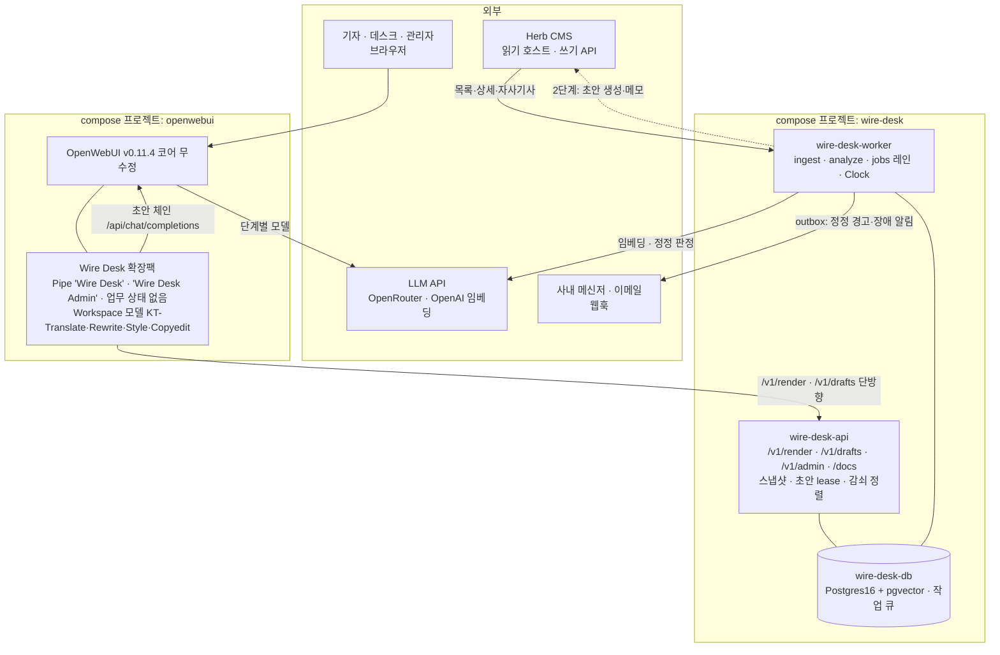

# Handoff v2 (r8): Wire Desk PoC — Herb 통신사 기사 추천·초안 파이프라인 타당성 검증

- 작성일: 2026-10-12, r6·r7 개정 2026-10-13, r8 개정 2026-10-14 (v1: 2026-10-08을 **대체**)
- 개정 이력
  - r1: V9 실측·실제 엔드포인트 반영
  - r2: 데이터 보존 정책, 자동 정리, 관리자 인터페이스
  - r3: OWU 업데이트 내성·서비스 독립성·과부하 방지 기준 재구성 (프로세스 4→2, 확장팩, Pipe 계약)
  - r4: 초안 체인을 OWU로 이전 (단계별 Workspace 모델, 1건씩 생성, `/v1/drafts` 기록)
  - r5 (2026-10-12): 계획 검증 결과 병합 — `handoff-v2.1`(r2 기준 검증 반영본, P0 6건·P1 7건)과 `handoff-v2-review`(r4 검증, CRITICAL 7·MEDIUM 7·MINOR 3)를 r4 구조에 맞게 통합
  - r6 (2026-10-13): 인기 점수 전략 보강 — 국내·해외 사안 분리 추천(각 10건), 시간 감쇠(반감기 6시간), 국내 편향 측정 지표 추가
  - r7 (2026-10-13): r6 리뷰 반영 — CRITICAL 3(G18 로컬 업그레이드 경로, 롤백 시 OWU 데이터 복원, 감쇠 기준 시각 정의), MEDIUM 6, MINOR 5
  - **r8 (2026-10-14): 아키텍처 초안 v3 권고 채택 (A1~A6)** — 사안 범위를 통신사 출신 비율 → **한국 관련성(단조)**으로, 추천 스냅샷을 채팅 이력 표식 → **서버 보관**으로, 초안 동시성을 Pipe 메모리 → **DB lease**로, D5 확인을 **착수일 병행 트랙**으로. **이 문서가 유일한 기준 문서이며 r7(`-v2-r7.md`)은 대체됨**
- 작성: Kwak (Multi-AI Desk 담당)
- 수신: 개발 에이전트 (Claude Code CLI, 로컬 개발 머신)
- 근거 문서: `herb-wire-api-request-v9.md` (같은 폴더, V9 요청서 Markdown 변환본). **두 문서가 다르면 이 문서가 우선**
- 저장 위치: `~/projects/openwebui-service/docs/plan/2026-10-12-wire-desk-poc-handoff-v2-r8.md` (AGENTS.md: 확정 계획 = `docs/plan/`). 정본은 이 파일 하나다. 같은 폴더의 `-v2.md`(r4)·`-v2.1.md`·`-v2-r6.md`·`-v2-r7.md`는 대체됐으므로 커밋하지 않는다(정리는 Kwak). 검증 기록 `-v2-review.md`와 아키텍처 초안 `2026-10-13-wire-desk-architecture-draft-v3.md`는 근거 문서로 남긴다
- 대상 OWU: **v0.11.4** (이미지 `v0.11.4-kwh.1`). G18 업그레이드 대상은 **`v0.12.0-kwh.1`**(2026-10-13 빌드 완료, 운영 배포 요청 #58과 같은 경로)
- 타임박스: **축소안 8일 / 전체 범위 12.5일** (§7). 1일차 스파이크(T0)가 실패하면 즉시 중단하고 보고한다. 4일차 체크포인트에서 G1~G4 측정값이 없으면 축소안으로 전환한다. **D5 회신도 4일차 체크포인트에서 함께 판단한다.**
- 최종 산출물: PoC 코드(별도 저장소, §5.3) + OWU 확장팩 + `docs/plan/2026-10-XX-wire-desk-poc-feasibility-report.md`

### 설계 목표 (모든 결정의 판단 기준)
1. **개발 단순성**: 컨테이너·프로세스·화면 수를 최소로. 새 프레임워크·새 화면 스택을 추가하지 않는다.
2. **화면은 OpenWebUI 안에**: 기자·관리자 화면은 OWU Pipe로 제공한다. 별도 웹 콘솔은 만들지 않는다.
3. **OWU 업데이트 = 이미지 교체 + 확장팩 설치 명령 1회**: 그 외 수작업 없이 모든 기능 정상. 중단 시간은 OWU 재시작 + 설치 시간뿐.
4. **데이터·처리 독립**: OWU가 멈추거나 업데이트 중이어도 수집·분석·정리·정정 경고·Herb 쓰기는 계속 동작한다. 사람이 OWU에서 하는 일(추천 확인·선정·초안 생성)만 OWU와 함께 멈춘다. 업무 데이터의 원본은 wire-desk가 소유한다. **(r8) 추천 스냅샷·초안 동시성 같은 업무 상태도 wire-desk가 소유하며, Pipe는 업무 상태를 갖지 않는다.**
5. **과부하 격리**: 모든 서비스 경계에 숫자로 된 상한을 둔다.
6. **경계 규칙** (r5 문구 수정): **사람이 실행을 요청하고 결과를 그 자리에서 검토하는 단계 = OWU. 일정에 따라 또는 이벤트에 반응해 사람 없이 실행되는 단계 = wire-desk.** 새 단계도 이 규칙으로 배치한다. 예: 팩트체크(기자 요청·승인)·제목 후보 → OWU, 정정 감지·보존 정리 → wire-desk.

### r7 대비 주요 변경 (r8) — 아키텍처 초안 v3 권고 채택
| 초안 v3 | 항목 | r7 | r8 |
|---|---|---|---|
| ① · A1 | 사안 범위 기준 | 통신사 출신 비율 (`국내 ≥ 1 그리고 해외 ≤ 국내`). 확산형 한국 사안이 해외로 이동, 외신 단독 한국 기사는 해외, 연합 국제부 기사는 국내로 분류 | **`korea_related`** = 사안 안 item 중 하나라도 (a) 국내 통신사의 비국제 데스크 기사 또는 (b) 제목+첫 문단이 `korea_terms.yaml`과 일치. **단조(false→true만)** (§5.5④) |
| ① | 범위 전환 기록 | `scope_changed_at`·`scope_changes`·`(국내→해외)` 표기, 열린 결정 "범위 고정 여부" | **삭제** (단조 규칙이라 전환이 한 방향·최대 1회) |
| ① | 목록 이름 | 국내 사안 (1~10) / 해외 사안 (11~20) | **한국 관련 (1~10) / 국제 (11~20)** |
| ① · A2 | 북한 사안 | 정의 없음 | **한국 관련에 포함** (`korea_terms.yaml`에 북한 항목) |
| ① | 픽스처 | 연합 국제부 기사 없음, 한국 고유명사 출처 미지정 | `foreign_led` 35개 중 10개에 **연합 국문 국제부 기사** 포함, 한국 관련 기사 생성용 고유명사 목록은 사전과 **별도**·30%는 사전 밖 (§6.2) |
| ① | G7 ③ | 정확도 = `domestic_led`·`foreign_led`만 (자기충족) | **88개 전체 ≥ 0.90**, `foreign_only` 재현율 ≥ 0.80, `spreading` 8/8 유지, 연합 국제부 포함 사안 국제 분류 ≥ 9/10, 사전 홀드아웃 손실 별도 보고 |
| ② · A3 | 추천 스냅샷 전달 | 응답 끝 `<!-- snapshot:ID -->` 표식을 Pipe가 `body["messages"]`에서 탐색 | **`user_snapshots`에 사용자별 최신 스냅샷 서버 보관**. `선정`은 최신 스냅샷 기준, 응답에 기준 시각 표시 |
| ② | Pipe 계약 | v1.1 (직전 assistant 메시지 의존) | **v1.2** = 마지막 user 메시지 + `__user__` email·role + HTTP 2개 |
| ③ · A3 | 초안 동시성 | Pipe 인스턴스 `_running` (Function 갱신·멀티 워커 시 무효) | **`drafts` lease** (사용자당 1·전체 5, 150초, 단계 기록마다 연장) (§5.5⑥) |
| ④ · A5 | D5 확인 시점 | 실데이터 사용 전 | **착수일 사내 요청, T5 착수(4일차) 전 회신 목표.** 금지 시 4일차 체크포인트에서 재계획 |
| A4 | 운영 기능 (보존·Admin) | 유지 | **유지** (r7과 동일, 일정 여유 기준) |
| A6 | 실데이터 Shadow 단계 | 언급 없음 | **범위 밖**. 추천 적중률 지표와 함께 별도 계획 문서로 (§4.2) |
| — | 일정 | 13일 / 8.5일 | **12.5일 / 8일** (§7) |

### r6 대비 주요 변경 (r7) — r6 리뷰 반영
| 리뷰 | 항목 | r6 | r7 |
|---|---|---|---|
| C1 | G18 로컬 업그레이드 경로 | `owu-upgrade`가 운영형 `.env`의 `OWU_TAG`·기본 compose 대상. local-test compose(`OPENWEBUI_LOCAL_TEST_TAG` 환경변수)와 맞지 않고, 수동 `network connect`가 컨테이너 재생성 시 사라져 G18이 항상 실패 | **PoC 전용 `owu-upgrade-local`/`owu-rollback-local`** (local-test compose, 기동 후 `poc-net` 재연결). 경로 `v0.11.4-kwh.1 → v0.12.0-kwh.1` 고정 (§5.5⑩) |
| C2 | 롤백 시 OWU DB | 이미지만 되돌림. v0.12.0-kwh.1은 alembic 마이그레이션 6단계를 적용(2026-10-13 리허설)하므로 구버전이 새 revision을 모름 | **이미지 교체 직전 정지 상태 백업 → 롤백 시 데이터 복원 + 이전 이미지**. G18에 "롤백 후 `alembic current` = 업그레이드 전 revision, integrity ok" 추가 |
| C3 | 감쇠 기준 시각 | `last_item_at` 갱신 조건 미정 (판 갱신·늦은 도착이 감쇠를 초기화할 수 있음) | **`last_item_at` = 갱신 대상 item의 `max(created_dt)`**, 새 edition·새 통신사 합류만 갱신. 판 갱신·정정·취소 공지·수신 시각은 미반영 (§5.5④) |
| M1 | 범위 전환 | 재계산 여부·전환 처리 미정 | 재계산 유지 + 전환 기록 (**r8에서 단조 규칙으로 대체·삭제**) |
| M2 | 범위 라벨 의미 | `event_scope` 정의 없음 (규칙과 같은 것을 잴 위험) | **`event_scope` = 편집 기준(한국 관련 여부)**, 보도 구성은 별도 필드 `coverage` |
| M3 | 정체 사안 기준 | 상대 순위만, 범위 구성 미지정 | 국내 4·해외 6, 정체 구간에 판 갱신·늦은 도착 혼입, 절대 기준(감쇠 계수 0.25 ± 1%) 추가 |
| M4 | 단일 vs 분리 비교 | 감쇠 효과와 섞임 | **감쇠 on/off × 단일/분리 목록 2×2** |
| M5 | 감쇠 점수 저장·만료 | `clusters.score` 주기 갱신, `expired` 조건 없음 | **api가 스냅샷 생성 시 계산**(`score` 컬럼 삭제), `expired` = `last_item_at` 후 48시간 |
| M6 | 일정 | 12일 / 8일 (r6 작업 미반영) | **13일 / 8.5일** |
| m1~m5 | 문서 정합성 | | 참조 문구, 정본 파일명, 언어권 정규화 식·`eval/config.yaml` 분리, 연합 1기관 계수 비교값, r7 재검증 |
| (r7 추가) | 확장팩 설치 `/health` 대기 | 최대 120초 | **기본 600초**(`OWU_HEALTH_TIMEOUT`). 로컬 기동 실측 121~520초 (AGENTS.md) |
| (r7 추가) | G18 데이터 디렉터리 | 미정 | `scripts/local-test.sh` 축적 데이터와 **별도 디렉터리**(`LT_DATA`)로 PoC OWU 운용 |

### r5 대비 주요 변경 (r6) — 인기 점수 전략
| 항목 | r5 | r6 |
|---|---|---|
| 추천 목록 | 점수 상위 20건 단일 목록 | **국내 사안 상위 10 + 해외 사안 상위 10** (번호 1~10 국내, 11~20 해외) (**r8: 한국 관련 / 국제**) |
| 시간 경과 | 감쇠 없음 (24~48시간 상위 잔존 가능) | **반감기 6시간 감쇠**: 마지막 기사 이후 경과 시간 기준 |
| 사안 범위 분류 | 없음 | `clusters.scope` 규칙 기본값 (**r8: `korea_related`로 대체**) |
| 국내 편향 측정 | 없음 | G7에 상위 진입률, 범위 분류 정확도, 감쇠 효과, 정규화 대안 비교 추가 |
| 언어권 정규화·카테고리 상한 | 없음 | 운영 점수에는 넣지 않고 **평가 스크립트에서 비교값만 산출** (실데이터 후 결정) |

배경: r5 점수의 `3 × agency_count`는 국내 사안(연합 국문·영문·한국일보, 최대 3곳 = 9점)과 해외 사안(최대 9곳 = 27점)의 상한이 달라, Korea Times에 가장 중요한 "한국 사안인데 아직 영문으로 안 쓴 것"이 구조적으로 밀린다. 점수식을 크게 바꾸지 않고 목록을 나눠 비교 자체를 분리한다. **r8: 목록을 나누는 기준은 이 목적에 맞춰 "누가 보도했나"가 아니라 "한국에 관한 사안인가"로 한다.**

### r4 대비 주요 변경 (r5)
| 출처 | 항목 | r4 | r5 |
|---|---|---|---|
| v2.1 P0-1 · 리뷰 C1 | 시간 가상화 | Mock에만 `REPLAY_SPEED` | **공유 `Clock`**: 모든 주기·창·윈도우가 가상 시간 (§3.1-6, §5.5⓪) |
| v2.1 P0-2 · 리뷰 C2 | 늦은 도착 | 1시간 재조회 `hk,scmp`만 | **전체 통신사 24시간 재조회**, 미확인 ID만 상세, Mock 지연 분포 명시 |
| v2.1 P0-3 | G3 백필 | 48시간 ≤ 20분 | **24시간 실측 → 48시간 환산 ≤ 60분** |
| v2.1 P0-4 · 리뷰 I6 | 호출량 | 신규 전량 상세, SCMP 재조회 누락 | **목록 단계 사전 스킵** + SCMP 재조회 분산, 호출량 표 재계산 |
| v2.1 P0-5 | 판 연결 위치 | ingest가 유사도까지 | **결정적 = ingest 레인, 유사도 병합 = analyze 레인 첫 단계** |
| v2.1 P0-6 · 리뷰 C4 | 개발 PC 메모리 | 고려 없음 | **BGE-M3는 OWU 정지 상태 오프라인 배치**, G14·G19 구성별 분리 |
| v2.1 P1-1 · 리뷰 I2 | 선정 경합 | 순위 번호 | **`snapshot_id` 기준 선정** (r8: 서버 보관 스냅샷) |
| v2.1 P1-2 | 초안 재시도 | 처음부터 | **단계 단위 재개** (Pipe가 완료 단계 기록, 재요청 시 이어서) |
| v2.1 P1-3 · 리뷰 C6 | 정정 의미 | hk "(수정)"·REFILE을 정정으로 | **판 갱신/정정/취소 3분류**, ID 유지 통신사는 LLM 매칭 생략 |
| v2.1 P1-4 · 리뷰 C5·I7 | 혼합 언어 사안 | 규칙 없음, 원문 단순 연결 | **기준 원문 1건 + 참고 최대 3건, 입력 상한 6,000토큰** |
| v2.1 P1-5 | 코드 위치 | fork 내 `services/` | **별도 저장소** `kwh8121/wire-desk-poc` (D3) |
| v2.1 P1-6 | Pipe | notices 반복 | **읽음 처리**, 멀티모달 `content` 처리 |
| v2.1 P1-7 | analyze 트리거 | 2분 주기 | **같은 worker 안 `asyncio.Event`로 즉시 깨움 + 10초 폴백** (LISTEN/NOTIFY 불필요) |
| 리뷰 C3 | 네트워크 | `aidesk-net`(없음) | **설정값**: PoC `wire-desk-poc-net` 생성 + 로컬 OWU 연결, 운영 `shared_bridge_network` |
| 리뷰 C7 · R2 | 전재 계약 | 임베딩만 대안 | **실데이터 사용·운영 전환의 선행 조건**으로 명문화, 금지 시 대안 경로, `source=real` 외부 호출 차단 |
| 리뷰 I1 | 단계 타임아웃 | 90초 × 3 | **30초**, G9 p95 ≤ 90초 / 상한 120초 |
| 리뷰 I3 | 임베딩 저장 | 단일 컬럼 | **`item_embeddings(item_id, model, vec)`** |
| 리뷰 I4 · R1 | 경계 규칙 | 문구 부정확 | 설계 목표 6 문구 수정 |
| 리뷰 I5 | 회로 차단기 | 모든 실패 집계 | **연결·타임아웃 오류만 집계**, 전역 차단은 의도된 동작으로 명시 |
| 리뷰 §5 | 자기충족 지표 | G6·G7만 잠정 | **G5·G8도 잠정**, 픽스처 표현 다양성·미등록 표기 홀드아웃, G15 독립 기대값, 점수식 급증 상한 |
| 리뷰 M1·M2·M3 | 표기 | v0.11.3, 동시 20명, `docs/jobs/plan/` | v0.11.4, 동시 15명 + 429 0건, `docs/plan/` |
| 리뷰 §7 | 미확인 사항 | 7건 | **소스 확인 완료 8건**, 잔여 3건은 T0 스파이크 |

---

## 0. 이 문서를 읽는 법

- **§3.1 고정 결정**은 다시 논의하지 않는다. 바꿔야 할 근거가 생기면 보고서의 "재검토 요청"에 적는다.
- **§3.2 열린 결정**은 에이전트가 정하고 근거를 보고서에 남긴다.
- **§11 미확인 사항**은 추측으로 메우지 않는다. 어댑터·설정으로 분리한다.
- 목적은 완성이 아니라 **판정**이다. 다듬기보다 §8 측정값 확보에 시간을 쓴다.
- 워크플로: Linear 2단계(계획 검증)를 거쳐 `plan-approved`가 된 뒤 착수한다 (AGENTS.md §"개발·릴리스 워크플로"). 2026-10-12 검증은 r4 대상이었으므로 r5~r8 변경분(특히 r6 점수 전략, r7 G18 절차, **r8 한국 관련성 분류·스냅샷 서버 보관·초안 lease**)을 포함해 **r8로 `needs-review` 재검증**을 받는다. `plan-approved` 코멘트에 승인 대상 리비전(r8)을 적는다.

### Kwak 확정 사항 — 아래 값을 문서에 반영함

| # | 항목 | 반영한 값 | 대안 |
|---|---|---|---|
| D1 | 판 연결 분할 | 결정적 판 연결 = ingest 레인, 유사도 병합 = analyze 레인 첫 단계 | (같은 worker 프로세스라 메모리 문제 없음 — 대안 불필요) |
| D2 | 합성 픽스처의 외부 API 전송·커밋 | 허용 (통신사 원문이 아님) | 금지 시 OpenAI 임베딩·OpenRouter 판정·초안 체인 측정 불가 |
| D3 | PoC 코드 위치 | 별도 저장소 `kwh8121/wire-desk-poc`(private). fork에는 보고서·jobs 로그만 | fork 내 `feature/wire-desk-poc` 브랜치에만 두고 main 병합 안 함 |
| D4 | G3 백필 기준 | 24시간 실측 → 48시간 환산 ≤ 60분 | 백필 전용 레이트 리밋 상향(한국일보 회신 의존) |
| D5 | 전재 계약 확인 시점 | **(r8) 착수일 사내 요청, T5 착수(4일차) 전 회신 목표.** 실데이터 사용 전 + 운영 전환 전 확정은 필수. 합성 픽스처 PoC는 회신 전에도 진행 | 확인 전까지 초안 체인 측정을 보류 (PoC 범위 축소) |
| D6 (r8) | 사안 범위 기준 | **한국 관련성(단조)**, 목록 이름 "한국 관련 / 국제" (초안 v3 A1) | r7 통신사 출신 비율 |
| D7 (r8) | 북한 사안 | **한국 관련에 포함** (초안 v3 A2) | 국제로 분류 |
| D8 (r8) | 스냅샷·초안 동시성 상태 위치 | **wire-desk DB** (`user_snapshots`, `drafts` lease) (초안 v3 A3) | r7 채팅 이력 표식·Pipe 메모리 |
| D9 (r8) | PoC 운영 기능 범위 | **r7 유지** (보존 정책·Admin 명령 전부) (초안 v3 A4) | 자동 정리·`현황`·`기사`만 남기고 0.5일 절감 |

---

## 1. 목적: 답해야 할 질문

| ID | 질문 | 판정 근거 (§8) |
|---|---|---|
| Q1 | 현재 Herb API로 누락·중복 없이 수집할 수 있는가? V9 보완 2건이 없을 때 무엇을 놓치는가? | G1, G2, G3 |
| Q2 | 통신사별 판 연결과 제외 필터가 정확한가? | G4, G5 |
| Q3 | 다국어 임베딩 증분 클러스터링으로 같은 사안을 국문·영문 넘어 묶을 수 있는가? | G6 |
| Q4 | 인기 점수·시간 감쇠·한국 관련/국제 분리 추천과 KT 기작성 제외가 의도대로 동작하고, **한국 관련 사안이 구조적으로 밀리지 않는가?** | G7 |
| Q5 | 판 갱신과 정정·취소를 구분해 감지하고, 원문·초안·담당자에게 전달할 수 있는가? | G8 |
| Q6 | OWU Pipe 초안 체인이 혼합 언어 사안을 포함해 정해진 규칙대로 동작하고, 결과가 wire-desk에 빠짐없이 기록되는가? | G9 |
| Q7 | OWU 코어 수정 없이 확장팩으로 화면을 제공하고, OWU 업데이트 후 설치 명령 1회로 정상화되는가? | G10, G11, G12, G18 |
| Q8 | 호출량·비용·서버 자원이 한도 안에 있고, 서비스 간 과부하가 격리되는가? | G13, G14, G19 |
| Q9 | 보존 정책대로 데이터를 안전하게 정리하고, 관리자가 현황·리스트·이력을 확인·통제할 수 있는가? | G15, G16, G17 |

---

## 2. 배경

### 2.1 업무 맥락
- Korea Times는 Herb CMS(한국일보 개발)로 기사를 만든다. Herb에는 통신사 9개 피드가 수신된다.
- Multi-AI Desk(aidesk.koreatimes.co.kr, OpenWebUI v0.11.4, 이미지 `v0.11.4-kwh.1`)가 "지금 관심이 몰리는데 KT가 아직 영문으로 쓰지 않은 사안"을 추천하고, 담당자가 선정하면 영문 초안을 만든다.
- OpenWebUI는 릴리스가 잦다. OWU만 업데이트해도 wire-desk는 영향이 없어야 한다.
- 한국일보에 요청서 V9를 보냈다. 1단계(읽기) 10/16 희망, 2단계(초안 생성·메모 쓰기) 11/15 희망.
- **이 PoC는 Herb 서비스 토큰 없이 Mock Herb와 합성 픽스처로 진행한다.**

### 2.2 MVP 업무 흐름 (V9)
1. 2분 간격 신규·변경 기사 조회
2. 스포츠 기록표·일정표, 연합 보도자료(RPR), 같은 통신사 같은 제목 중복 제외
3. 남은 기사로 사안 묶기, 인기 점수 계산
4. 최근 24시간 KT 작성·발행 사안 제외
5. 상위 20건 추천 → 담당자 최대 10건 선정 (r8: 한국 관련 10 + 국제 10)
6. 번역·리라이트·스타일링·교열로 영문 초안 생성
7. 1단계: 담당자가 Herb에 붙여넣기 / 2단계: Herb에 초안 자동 저장
8. 원문 정정·취소 감지 시 담당자 경고, 2단계에서는 초안에 기사 메모
9. 사진·검수·발행은 Herb에서 사람이
10. 발행 여부·최종본·수정 이력으로 수정량·발행 비율 측정

### 2.3 통신사와 실측 수신량 (2026-10-11 10:30 ~ 10-12 10:30, 주말 24시간)

| 통신사 (Herb 코드) | 언어 | 24시간 | 특이 사항 | AI 체인 |
|---|---|---|---|---|
| Reuters (RT) | en | 830 | FRB·FRW 두 피드로 같은 기사 동시 수신 | 리라이트 → 스타일 → 교열 |
| 연합 국문 (yna_ko) | ko | 658 | RPR 16건 포함 | 번역 → 스타일 → 교열 |
| AP (ap) | en | 646 | 같은 제목이 새 ID로 최대 9회 재수신 | 리라이트 → 스타일 → 교열 |
| AFP (AF) | en | 343 | | 리라이트 → 스타일 → 교열 |
| 한국일보 (hk) | ko | 189 | 같은 ID 갱신, 제목에 "(수정)" | 번역 → 스타일 → 교열 |
| DPA (DP) | en | 96 | 전부 `urgencyType` 긴급 | 리라이트 → 스타일 → 교열 |
| 연합 영문 (yna_en) | en | 32 | 수신량 적음(원인 미확인) | 스타일 → 교열 |
| SCMP (scmp) | en | 30 | 같은 ID 갱신 | 리라이트 → 스타일 → 교열 |
| UPI (UP) | en | 23 | | 리라이트 → 스타일 → 교열 |
| **합계** | | **2,847** | **평일 약 4,600건** (10/1 4,562, 7/1 4,723) | |

- 시간당 최대 254건.
- 스포츠 기록표·일정표 588건(20.6%), 같은 통신사 같은 제목 중복 601건. 이들과 RPR을 빼면 1,871건(65.7%)이 분석 대상.
- 2,847 − 588 − 601 − 16 = 1,642와 V9의 1,871 사이 차이 229건(8.0%)은 기록표이면서 중복 제목인 겹침으로 본다(픽스처에 반영, §6.2).
- 7월 1일 기사까지 조회되므로 48시간 백필 가능.

### 2.4 통신사별 판(edition) 처리 방식 (V9, XML 확인 결과)

| 통신사 | 수정판 수신 방식 | 판 연결 키 | 수정 감지 |
|---|---|---|---|
| 연합 국문·영문 | 같은 `ContentID`로 재전송, XML Header `Action` = C(신규)/U(수정) | XML `ContentID` | `Action` (삭제 코드 존재 여부 미확인) |
| 한국일보 | 같은 `deliveryId` 행 갱신 | `deliveryId` | `updatedDt` 변화, 제목 "(수정)"(판 갱신)·"(삭제)"(취소) |
| SCMP | 같은 `deliveryId` 행 갱신 | `deliveryId` | `updatedDt` 변화만 (제목 불변) |
| Reuters, AP, AFP, DPA, UPI | 판마다 새 `ContentID`, `Action` 항상 C | 없음 | 제목 정규화 일치 → 임베딩 유사도로 판 묶음 |

**용어 (r5 확정)**: **판 갱신**(revision) = 같은 기사의 새 판, 경고 대상 아님 / **정정**(correction) = 사실 오류 수정 공지 / **취소**(kill) = 기사 철회. 한국일보 "(수정)"과 Reuters `REFILE`은 판 갱신이다.

**용어 (r8 확정)**: **한국 관련**(`korea_related`) = 편집 기준으로 한국(북한 포함)에 관한 사안. 보도한 통신사의 국적과 무관하다. **국제** = 그 외 사안.

### 2.5 Herb API (V9, 웹 화면 네트워크 호출에서 확인)

| No | 용도 | 엔드포인트 | 단계 |
|---|---|---|---|
| 1 | 통신사 기사 목록·검색 | `GET /api/delivery2` | 1 |
| 2 | 통신사 기사 상세 | `GET /api/delivery/{deliveryId}` | 1 |
| 3 | 자사 기사 조회·수정 이력 | `/api/article`, `/api/article/history` | 1 |
| 4 | 서비스 계정·토큰 | (신규 발급) | 1 |
| 5 | 초안 생성 | "기사작성" 기능의 생성 API (경로 미확인) | 2 |
| 6 | 초안 경고 메모 | `/api/articlememo` | 2 |
| 7 | 코드 조회 | `/api/delivery/category2`, `/api/dept/all` | 1 |

**`GET /api/delivery2`**
- 파라미터: `deliverySource`, `deliveryCategory`, `fromDate`, `toDate`(분 단위), `urgencyType`, `searchText`, `andSearchText`, `includeWord`, `excludeWord`, `searchTitleYn`, `page`, `size`, `sortValue`(`YD` 최신순, `YA` 오래된순)
- 응답: `deliveryId`, `deliverySource`, `deliveryArticleTitle`, `urgencyType`, `categoryList`, `deliveryYmd`, `page{number,size,totalElements,totalPages}`
- **목록 응답에 `updatedDt` 없음.** `deliveryYmd`는 수정 시 바뀌지 않는 경우가 있다 (예: `scmp_3370461`, deliveryYmd 10-11 17:30 고정, updatedDt만 10-12 01:55로 변경).
- `fromDate`·`toDate`의 필터 기준 필드는 `deliveryYmd`로 가정 (§11).
- V9 보완 요청(미승인): ① 목록 응답에 `updatedDt` 추가 ② `updatedFrom`(초 단위) 조건 + `updatedDt` 오름차순 정렬

**`GET /api/delivery/{deliveryId}`** 응답 → 내부 필드 매핑

| 내부 필드 | Herb 필드 |
|---|---|
| herb_id, agency, agency_item_id | `deliveryId`, `deliverySource`, XML `ContentID` (한국일보는 `guid`) |
| headline | `deliveryArticleTitle` |
| body_text | `deliveryPlainContents` |
| body_raw | `deliveryXMLContents` |
| byline, desk, region, class_code | XML `Writer`, `Desk`, `Region`, `ClassCode` (연합 기준) |
| category | `deliveryCategory`, `deliverySubCategory`, `deliveryTag` |
| priority | XML `Urgency` (원본). `urgencyType`은 참고만 |
| received_at / list_time / updated_at | `createdDt` / `deliveryYmd` / `updatedDt` |
| action | XML Header `Action` |
| review_complete | `reviewComplete` (의미 미확인) |

---

## 3. 결정 사항

### 3.1 고정 결정 (재논의 금지)

**구조**
1. **역할 분담 = 경계 규칙(설계 목표 6)**: OWU = 화면(Pipe 2개), 로그인, 권한, 초안 체인(단계별 Workspace 모델). wire-desk = Herb 연동(읽기·쓰기), 수집·분석·점수·정정 감지·알림·보존·측정, 모든 업무 데이터와 업무 상태(추천 스냅샷·초안 동시성)의 원본.
2. **wire-desk 구성**: 이미지 1개, 컨테이너 3개 — `wire-desk-api`, `wire-desk-worker`, `wire-desk-db`.
3. **worker는 1개 프로세스, 3개 레인** (asyncio 태스크, 레인별 세마포어):
   - `ingest`: 폴링·상세 조회·**결정적 판 연결**(ID·정규화 제목·content_hash). Herb 폴링 스케줄러는 여기만
   - `analyze`: **유사도 판 병합**(첫 단계)·필터·임베딩·묶기·점수·**한국 관련성 판정**·KT 제외·판 갱신/정정/취소 분류. ingest가 신규를 저장하면 **프로세스 내부 `asyncio.Event`로 즉시 깨우고**, 10초(가상 시간) 폴백 루프를 둔다
   - `jobs`: Herb 쓰기·메모·측정·보존 정리·알림 발송
   - 로컬 BGE-M3는 상시 파이프라인에 넣지 않는다(오프라인 배치 비교만).
4. **api와 worker는 DB로만 소통**: 작업 큐는 Postgres `jobs` + `SELECT ... FOR UPDATE SKIP LOCKED`. Redis, Celery 사용 안 함.
5. **DB**: Postgres 16 + pgvector, OWU DB와 완전 분리 (One Fact One Home).
6. **시간은 `Clock`으로만**: `datetime.now()` 직접 호출 금지. 주기·조회 창·6/24/48시간 윈도우·`growth_1h`·heartbeat·스냅샷 만료·**초안 lease**·보존 기간은 모두 `wire_desk/clock.py` 경유. 운영은 실시간, PoC 재생은 Mock 가상 시각(§5.5⓪).
7. **프레임워크**: Python 3.12, FastAPI, httpx, asyncpg 또는 SQLAlchemy 2. **LangChain/LangGraph 사용 안 함.**

**독립성·OWU 업데이트 내성**
8. **런타임 호출은 OWU → wire-desk 단방향**: wire-desk는 실행 중에 OWU를 호출하지 않는다.
9. **초안 체인은 OWU에서**: 단계마다 Workspace 모델 1개(KT-Translate, KT-Rewrite, KT-Style, KT-Copyedit). 기자용 Pipe가 Valves의 체인 목록(`CHAIN_TRANSLATE`, `CHAIN_REWRITE`, `CHAIN_STYLE_ONLY`)대로 OWU `/api/chat/completions`를 서비스 계정 API 키로 호출한다. 단계 추가 = Workspace 모델 생성 + Valves 목록에 ID 추가. 프롬프트는 Workspace 모델이 소유하며 데스크가 OWU 화면에서 편집한다.
   - **전제 조건 (D5)**: 초안 체인은 원문 전문을 외부 LLM에 보낸다. **실데이터 사용과 운영 전환 전에 전재 계약상 외부 LLM 전송 허용 여부를 사내 확인한다(r8: 착수일 요청).** 금지로 확인되면 대안 경로 ① 데이터 미보존(zero retention) 조건의 상용 API 계약, ② 사내 LLM(품질·서버 비용 별도 검증) 중 하나를 택한다. 이때도 OWU Workspace 모델의 base model만 바꾸면 되도록 체인 구조는 유지한다.
10. **초안 결과는 wire-desk에 기록**: Pipe가 단계마다 `PUT /v1/drafts/{client_draft_key}`로 완료 단계를 기록하고, 마지막 단계 후 `final`로 확정한다. 정정 경고 연결·2단계 Herb 저장·측정은 이 기록 기준. 기록 실패 시 초안은 그대로 표시하고 "기록 실패: 정정 경고 연결 안 됨"을 덧붙이며 1회 재시도.
11. **OWU 연동은 확장팩**: `openwebui-ext/`에 Pipe(기자용·관리자용 공용 코드), Workspace 모델 4종, `manifest.yaml`, 멱등 `install.py`, `contract_test.py`. OWU 업데이트 후 `make owu-upgrade TAG=...` 한 번으로 이미지 교체 → 설치 → 계약 테스트 → 실패 시 자동 롤백. **PoC(로컬 local-test OWU)는 `make owu-upgrade-local`**을 쓰며, 이미지 교체 직전 OWU 데이터를 백업하고 롤백 시 이미지와 데이터를 함께 되돌린다(§5.5⑩). 운영 OWU 교체는 Protocol v1.2.1 배포 워크플로가 수행하고, 확장팩 설치·계약 테스트는 그 뒤 단계로 붙인다(전환 공수 §9-12).
12. **Pipe 계약 v1.2 (r8)**: Pipe가 쓰는 OWU 인터페이스는 `pipe(body, __user__, __event_emitter__=None)`, `body["messages"]`의 **마지막 사용자 메시지만**, `__user__["email"]`, `__user__["role"]`, OWU HTTP API `/api/chat/completions`뿐. 이전 assistant 메시지·채팅 이력은 읽지 않는다. **OWU 내부 Python 모듈(`open_webui.*`) import 금지.** `content`가 리스트(멀티모달)면 text 부분만 합친다. 추천·목록·관리 화면의 표·도움말·오류 문구는 wire-desk `POST /v1/render`가 만들고 Pipe는 전달만 한다. **Pipe는 업무 상태를 갖지 않는다**(스냅샷·초안 동시성은 wire-desk DB, §5.5⑥·⑦). 인스턴스 상태는 회로 차단기 카운터뿐이며, 잃어도 차단이 풀릴 뿐이다. Pipe의 업무 로직은 초안 체인 순서 실행 하나뿐. `__event_emitter__`·Rich UI·Action Function은 `try`로 감싼 부가 기능으로만.
13. **wire-desk API는 `/v1/` 접두사**: 양쪽을 따로 업그레이드해도 호환 유지.
14. **배포 분리**: OWU와 wire-desk는 별도 compose 프로젝트. 공유는 외부 Docker 네트워크 하나이며 **이름은 설정값**(PoC `wire-desk-poc-net` 신규 생성 후 로컬 OWU 컨테이너를 `docker network connect`, 운영 `shared_bridge_network`). 프로젝트 간 `depends_on` 금지. OWU compose 파일 수정 금지. 이미지 태그 고정(`latest` 금지).
15. **알림 경로 독립**: 정정·취소 경고와 wire-desk 장애 알림은 `outbox` → worker가 웹훅(사내 메신저 또는 이메일)으로 직접 발송, 실패 시 재시도. Pipe 상단 표시는 편의용 중복 경로.
16. **비상 경로**: FastAPI 자동 문서(`/docs`)를 관리자 토큰으로만 열어, 확장팩 고장 시에도 현황 조회·정리 실행 가능.

**과부하 격리**
17. **추천은 미리 계산, 선정은 서버 보관 스냅샷 기준 (r8)**: analyze 레인이 사안의 `raw_score`·`last_item_at`·`korea_related`를 갱신하고, api는 `추천` 요청마다 그 시점 Clock으로 감쇠 점수를 계산해(§5.5④) **한국 관련 사안 상위 10건(번호 1~10)과 국제 사안 상위 10건(번호 11~20)**을 `rec_snapshots`에 고정 저장하고, **`user_snapshots`에 그 사용자의 최신 `snapshot_id`를 기록**한다. 한쪽이 10건에 못 미치면 빈 자리는 비워 두고 다른 쪽으로 채우지 않는다(분리의 목적 유지). `선정 3 5 7`은 **그 사용자의 최신 스냅샷** 순위로 해석하고 응답에 "기준: HH:MM 추천(N분 전)"을 표시한다(2시간 경과 시 만료, "`추천`을 먼저 입력하세요").
18. **경계별 상한** (값은 `config.py`, 시작값):

| 경계 | 상한 |
|---|---|
| OWU → wire-desk api | 사용자당 분당 30회, 전체 동시 요청 20개, 초과 시 429 + 안내 |
| Pipe → api 타임아웃 | 연결 3초, 응답 20초. **연결·타임아웃 오류만** 3회 연속 시 30초 회로 차단(4xx·5xx 응답은 미집계). 차단은 wire-desk 서버 상태 기준이라 전역(모든 기자) 적용이 의도된 동작 |
| 선정·초안 | `선정`은 등록만(최대 10건, 즉시 응답). `초안 {번호}`는 1건만 체인 실행. 10건 일괄 생성 금지 |
| Pipe 초안 체인 → OWU `/api/chat/completions` | **동시 실행 사용자당 1건, 서버 전체 5건 — wire-desk `drafts` lease로 제어(r8, §5.5⑥)**, 초과 시 대기 안내. **단계 타임아웃 30초**, 사용자당 시간당 30건. 서비스 계정은 Rate Limit 예외 |
| 체인 입력 | 기준 원문 1건 + 참고 최대 3건, 합계 **6,000토큰 상한**(초과 시 참고 자료를 제목+첫 2문단으로 자름) |
| worker → LLM (정정 판정·임베딩) | 동시 3, 전용 키 월 크레딧 상한 |
| worker → Herb | 실시간 초당 5회, 동시 5개, 5xx·타임아웃 지수 백오프 3회 (재생 모드는 §5.5⓪ 스케일) |
| 같은 서버 자원 (compose 제한) | worker CPU 1 / 1GB, api CPU 0.5 / 512MB, db CPU 1 / 1GB |
| DB | 관리자 목록 20건 페이지 + 인덱스, 검색은 보존 기간 내, 정리는 04:10 KST 5,000행 배치 |

**데이터 처리**
19. **판 연결과 사안 묶기는 별개 단계**: 판 연결(같은 통신사 내부: 결정적 → 유사도 병합)이 먼저, 사안 묶기(통신사 간)는 그 뒤.
20. **사안 묶기는 증분 방식**: 전체 재클러스터링 금지. 사안 ID 안정성 우선.
21. **통신사별 규칙은 `agency_profiles.yaml`**: 코드에 통신사 분기 하드코딩 금지.
22. **Herb 어댑터 분리**: 필드명·엔드포인트·인증·토큰 갱신·호출 제한·시간대는 `herb_client`에만. 폴링은 읽기 전용 호스트(설정값).
23. **긴급도**: XML 원본 `Urgency`를 통신사별로 해석.
24. **보존 정책은 테이블별 차등**: 원문 계열 1~3일, 선정·초안·측정 180일. 초안 기록 시 원문을 `drafts.source_snapshot`에 복사.
25. **삭제 경로는 하나**: 모든 삭제는 `maintenance` 모듈로만. 자동·수동 같은 함수·같은 보호 규칙. 수동은 미리보기 → 확인 코드(5분) → 실행.
26. **Pipe에 통신사 원문 본문 출력 금지**: 추천 표는 제목 1줄, 초안은 AI 결과물만. (체인 호출은 `chat_id`가 없어 OWU 채팅 기록에 남지 않음 — 소스 확인, §11)
27. **데이터 정책 (D2·D5)**: 합성 픽스처는 외부 API 전송·커밋 허용. 실데이터(`fixtures/real/`)는 `source=real` 플래그로 **외부 호출 경로(OpenAI 임베딩·OpenRouter 판정·초안 체인)를 코드에서 차단**하고, BGE-M3 로컬 비교에만 쓴다. 외부 업로드·커밋 금지, `.gitignore` 등록.
28. **사안 범위 = 한국 관련성 (r8, D6·D7)**: 추천 목록 분리 기준은 편집 기준의 한국 관련 여부이며 통신사 국적 비율로 정하지 않는다. 판정은 결정적 규칙(국내 통신사 비국제 데스크 + 한국 사전)이고, **단조**(false→true만)다. 북한 사안은 한국 관련이다. 사전은 `korea_terms.yaml`, 데스크·카테고리 값은 `agency_profiles.yaml`(§5.5④). LLM 분류는 PoC에 넣지 않는다.

### 3.2 열린 결정 (에이전트가 정하고 근거 기록)
- 임베딩 모델: `text-embedding-3-small`(OpenAI, 상시) vs `BGE-M3`(로컬, 오프라인 배치) 비교 후 권장
- 임베딩 입력: 제목만 / 제목+첫 문단 / 제목+첫 2문단(약 300토큰)
- 유사도 임계값: 언어쌍(ko-ko, en-en, ko-en)별 분리 여부
- 외신 판 묶음: ingest 제목 정규화 + analyze 임베딩 병합(시작값 0.92, 6시간 창)의 조합
- 스포츠 기록표 판별: 규칙 vs 경량 분류기. **목록 단계(`categoryList`·제목)만으로 판별 가능한 비율**을 함께 측정 (상세 조회 스킵 근거)
- 혼합 언어 사안의 기준 원문 선택 세부 규칙 (§5.5⑥ 기본 규칙 안에서)
- **한국 관련성 규칙 세부 (r8)**: `korea_terms.yaml` 범위(시작 150~200항목)·검사 범위(제목+첫 문단 vs 제목+첫 2문단)·대소문자·약칭 처리. 신호 (a)만 / (b)만 / 둘 다의 정확도를 `eval/config.yaml` 비교값으로 산출 후 권장. 사전 밖 고유명사 손실과 지나가는 언급 오탐을 함께 보고
- **감쇠 반감기**: 시작값 6시간, G7 결과로 3·6·12시간 비교 후 권장
- **언어권 정규화·카테고리 상한 도입 여부**: 평가 스크립트 비교값(§8 G7)을 근거로 권장. PoC 운영 점수에는 넣지 않는다
- **연합 국문·영문 계수 (r7)**: 기본은 별개 통신사 2곳. 대안 "같은 기관(`org: yonhap`) 1곳"을 G7 ⑥ 비교값으로 산출 후 권장
- 정정·취소 판정용 경량 LLM(wire-desk), Workspace 모델 base model(OWU)
- 알림 웹훅 대상 (PoC는 로컬 수신기)
- 마이그레이션 도구 (Alembic 또는 SQL 파일)

(r8 삭제: "사안 범위 분류 규칙의 세부(연합 Region 보조)" → 고정 결정 28로 대체, "사안 범위 고정 여부" → 단조 규칙으로 불필요)

---

## 4. 범위

### 4.1 범위 안
- **T0 스파이크**: 잔여 미확인 3건(§11.2) 1일차 검증
- Mock Herb 서버 (`/__clock`, 지연 분포 포함, §6.3)
- 합성 픽스처 생성기 + 정답 라벨 + 홀드아웃 표기 (한국 고유명사 홀드아웃 포함)
- wire-desk `api`, `worker`(3레인), `db`, `clock.py`
- 한국 관련성 판정 + `korea_terms.yaml` (부록 H)
- 초안 체인: Workspace 모델 4종 + Pipe 체인 실행(단계 재개) + render의 원문 선택·입력 상한 + `/v1/drafts`(lease 포함) + 2단계 Herb 쓰기 경로(Mock)
- 보존 정책 + `maintenance` + `outbox` 알림
- OWU 확장팩: Pipe, Workspace 모델 4종, `manifest.yaml`, `install.py`, `contract_test.py`, `make owu-upgrade` / `owu-rollback`(운영형 참고) / `owu-upgrade-local` / `owu-rollback-local`(PoC, 데이터 백업·복원) / `ext-export` / `poc-net`
- 비상 경로 `/docs`, compose 자원 제한, 과부하 상한
- BGE-M3 오프라인 배치 비교 (`eval/bge_m3_offline.py`)
- 평가 스크립트 + 타당성 보고서

### 4.2 범위 밖
- 초안 **품질** 평가와 프롬프트 튜닝, 향후 편집 단계(제목 후보·팩트체크 등) 구현, Google Trends 신호, 별도 웹 콘솔·대시보드, 전용 선정 화면, 운영 배포, 실제 Herb 호출, 날짜별 파티션, OWU 코어 수정, OWU 저장소 CI와 계약 테스트 자동 연동(운영 전환 시 과제)
- **(r8) LLM 기반 한국 관련성 분류**: 규칙이 G7 ③ 기준에 미달할 때의 다음 후보로 보고서에 기록만
- **(r8) S1 Shadow 단계**(Herb 실데이터 읽기, 관리자 1명 추천 열람, **추천 적중률** = KT 발행 기사에 대응하는 사안이 발행 1시간 전 추천 20건 안에 있었던 비율): Herb 읽기 토큰 발급 후 별도 계획 문서로. 근거: 아키텍처 초안 v3 §6

---

## 5. 아키텍처

### 5.1 전체 구조



- **런타임 호출 방향**: 확장팩 → api 한 방향. wire-desk는 OWU를 호출하지 않는다.
- **초안 체인**: 기자가 OWU에서 요청 → api가 lease 획득 후 입력 반환 → Pipe가 같은 OWU의 단계별 모델 호출 → 단계마다 wire-desk에 기록. 선정과 초안이 모두 OWU에서 일어나므로 OWU 중단 시 새로 멈추는 기능은 없다.
- **OWU 업데이트 중**: worker는 계속 동작. 화면과 초안 생성만 재시작+설치 시간 동안 중단. 확장팩 재설치로 Pipe 인스턴스가 새로 만들어져도 스냅샷·lease는 DB에 있어 유지된다.
- **wire-desk 업데이트 중**: OWU의 다른 기능은 정상, Wire Desk Pipe는 3초 내 "일시 중단" 안내.

### 5.2 데이터 흐름

```mermaid
flowchart LR
  subgraph AUTO[worker 자동 처리 · Clock 기준]
    A1[수집<br/>2분 · 15분 창 + 1시간 전체 24h 재조회] --> A2[결정적 판 연결 · 사전 스킵<br/>ID · 제목 · content_hash]
    A2 -->|asyncio.Event| A3[유사도 판 병합 · 제외 필터<br/>임베딩 · 사안 묶기]
    A3 --> A4[점수 · 시간 감쇠 · 한국 관련성 판정<br/>KT 기작성 제외]
    A2 --> A5[판 갱신 / 정정 / 취소 분류<br/>Action · 제목 패턴]
  end
  subgraph HUMAN[OWU에서 기자 입력 이후]
    B1[추천<br/>한국 관련 10 + 국제 10 스냅샷<br/>user_snapshots 기록] --> B2[선정<br/>사용자 최신 스냅샷 순위로 등록]
    B2 --> B3[초안 체인<br/>'초안 N' · lease · 기준 원문 + 참고 · 1건씩]
    B3 --> B3a[/v1/drafts 단계별 기록<br/>wire-desk]
    B3a --> B4[Herb 반영<br/>1단계 붙여넣기 · 2단계 자동]
  end
  A4 --> B1
  A5 --> B5[경고<br/>웹훅 · Pipe 상단 · 2단계 articlememo]
```

측정 배치(하루 1회)와 보존 정리(매일 04:10 KST)는 worker의 jobs 레인이 처리한다.

### 5.3 저장소와 디렉터리 (D3)

`openwebui-service` fork에 넣으면 프런트 CI(`npm run format`, prettier가 md·json까지 대상), 백엔드 CI(`ruff format --check .` 루트 기준), Dockerfile `COPY . .`(픽스처가 빌드 컨텍스트에 포함), 릴리스 규약(`feature/* → integration → main`) 부작용이 있다. **별도 저장소 `kwh8121/wire-desk-poc`(private)에 둔다.** fork에는 보고서(`docs/plan/`)와 jobs 로그(`docs/jobs/`)만 정규 흐름으로 올린다.

```
wire-desk-poc/
  wire_desk/
    clock.py               # RealClock / ReplayClock (Mock /__clock 동기화)
    config.py              # 주기·임계값·가중치·동시성·상한·보존 기간·네트워크명·lease
    agency_profiles.yaml
    korea_terms.yaml       # r8: 한국 관련성 사전 (부록 H)
    herb_client.py         # 매핑, 인증·토큰 갱신, 레이트 리밋(실시간·재생 스케일), 읽기/쓰기 호스트
    db/schema.sql
    queue.py
    lanes/
      ingest.py            # 전략 A·B, 1시간 재조회, 사전 스킵, 상세, 결정적 판 연결
      analyze.py           # 유사도 판 병합, 필터, 임베딩, 묶기, 점수, 한국 관련성, KT 제외, 판 갱신/정정/취소 분류
      jobs.py              # herb_write, herb_memo, metrics, maintenance, outbox 발송
    korea.py               # r8: 한국 관련성 판정 (데스크·사전, 단조)
    llm.py                 # 정정 판정·임베딩 호출 (source=real 차단)
    maintenance.py         # 보존 정책 (유일한 삭제 경로)
    render.py              # Pipe용 Markdown 생성·명령 해석·스냅샷·초안 원문 선택·입력 조립
    api.py                 # /v1/render, /v1/drafts(lease), /v1/admin/*, /docs
    worker.py              # 3레인 기동, 스케줄러, asyncio.Event
  prompts/correction_judge.md
  mock_herb/server.py
  fixtures/                # generate.py, korea_entities_gen.yaml(사전과 별도), deliveries.jsonl, updates.jsonl, kt_articles.jsonl, labels.jsonl, real/(gitignore)
  eval/run_eval.py
  eval/config.yaml         # 비교값 전용 설정 (wire_desk 패키지는 읽지 않음)
  eval/bge_m3_offline.py
  tests/
  openwebui-ext/
    manifest.yaml
    functions/wire_desk_pipe.py
    models/                # kt-translate.json, kt-rewrite.json, kt-style.json, kt-copyedit.json
    install.py
    contract_test.py
  Dockerfile
  docker-compose.yml       # wire-desk 프로젝트 (운영형)
  docker-compose.poc.yml   # + mock-herb, 웹훅 수신기, wire-desk-poc-net
  Makefile                 # owu-upgrade(-local), owu-rollback(-local), ext-install, ext-test, ext-export, poc-net
```

### 5.4 데이터 모델 (최소)
- `deliveries`: herb_id UNIQUE, agency, agency_item_id, headline, body_text, body_raw(XML), action, urgency_raw, desk, category, created_dt, delivery_ymd, updated_dt, first_seen_at, last_seen_at, content_hash, source(`synthetic`|`real`)
- `items`: edition_id, excluded_reason(`sports_table`|`rpr`|`dup_title`|NULL), detail_skipped(bool), flag(`normal`|`revision`|`correction`|`kill`|`corrected`|`killed`), cluster_id, analyzed_at, pinned, pinned_by, pinned_at, **korea_hit(`desk`|`terms`|NULL, r8: item 단위 판정 결과)**
- `item_embeddings`: item_id, model(`openai-3-small`|`bge-m3`), vec(모델별 차원), created_at. UNIQUE(item_id, model)
- `editions`: agency 내부 판 묶음. latest_item_id, item_count, link_method(`id`|`title`|`content_hash`|`similarity`)
- `clusters`: centroid, first_seen, last_seen, last_item_at(감쇠 기준, §5.5④), agency_count, domestic_agency_count, foreign_agency_count(평가 비교값용), edition_count, growth_1h, raw_score, **korea_related(bool, 기본 false), korea_signal(`desk`|`terms`|NULL, 처음 true가 된 근거), korea_related_at NULL(r8)**, category_top, status(`active`|`kt_covered`|`needs_review`|`expired`), kt_article_id. 감쇠 점수는 저장하지 않는다(질의 시점 계산, r7). 인덱스 `(status, korea_related, last_item_at)`. **(r8 삭제: `scope`, `scope_changed_at`, `scope_changes`)**
- `kt_articles`: article_id UNIQUE, headline, body, status, section, created/published/updated, source_delivery_id NULL
- `rec_snapshots`: snapshot_id, user_email, created_at, rows JSON(rank(1~10 한국 관련, 11~20 국제) → cluster_id, korea_related, headline, agency_count, growth_1h, raw_score, score)
- **`user_snapshots` (r8)**: user_email PK, snapshot_id, created_at
- `selections`: id, snapshot_id, user_email, selected_at / `selection_items`: selection_id, rank_no(스냅샷 순위), cluster_id, status(`listed`|`drafting`|`drafted`). UNIQUE(snapshot_id, cluster_id)
- `jobs`: type(`herb_write`|`herb_memo`|`metrics`|`maintenance`), payload, status, attempts, locked_by, locked_at, heartbeat_at, error
- `drafts`: id, client_draft_key UNIQUE, selection_item_id, cluster_id, base_item_id, ref_item_ids, source_snapshot JSON, chain_name(`translate`|`rewrite`|`style_only`), step_outputs JSON(단계별 모델 ID·출력·완료 시각), owu_version, final_text NULL, user_email, status(`in_progress`|`final`|`failed`), herb_article_id NULL, **lease_owner NULL, lease_until NULL (r8)**, created_at, updated_at. 인덱스 `(lease_until)`
- `notices`: type, message, item_id, target_item_id NULL, draft_id NULL, user_email NULL(전체 공지), created_at, read_at
- `outbox`: id, channel, payload, status(`pending`|`sent`|`failed`), attempts, next_attempt_at, created_at
- `sync_state`, `api_calls`(target·endpoint·status_code·latency_ms·called_at·clock_time), `maintenance_runs`, `admin_confirmations`

### 5.5 처리 로직

**⓪ 시간 (Clock)**
- `CLOCK_MODE=real|replay`. `replay`이면 Mock `GET /__clock`(`{virtual_now, speed, started_at}`)에 동기화하고 모든 주기를 가상 시간으로 계산한다. 60배속에서 "2분 주기" = 실시간 2초.
- 조회 창(`fromDate=now-15m`)의 `now`도 Clock 값.
- Herb 레이트 리밋(초당 5회)은 실시간 보호 장치다. 재생 모드에서는 `RATE_LIMIT_SCALE`(기본 = `REPLAY_SPEED`)로 비례 완화하고, 호출량(G13)은 `api_calls`를 가상 하루로 환산해 판정한다.
- **초안 lease(150초)는 실시간 기준**이다. OWU 체인 호출은 재생 대상이 아니므로 `Clock`의 실시간 값(`clock.wall_now()`)을 쓴다.
- 개발 PC에서 60배속 처리가 밀리면 `REPLAY_SPEED=20`으로 낮추고 보고서에 기록한다.

**① 수집 (ingest 레인)** — `POLL_STRATEGY=v9|updated`
- 전략 A (`v9`, 실제 1단계 시작 방식)
  1. 2분마다 `fromDate=now-15m, toDate=now, sortValue=YA, size=500`, 페이지 끝까지
  2. `deliveryId`로 upsert, 신규만 상세 조회 대상 (4. 사전 스킵 적용)
  3. **1시간마다 전체 통신사 목록의 최근 24시간 재조회** (`size=500`, 평일 약 10페이지 → 약 240회/일)
     - 처음 보는 `deliveryId` → 상세 조회 (15분 창을 넘긴 늦은 도착분 회수)
     - 한국일보: 목록 제목 변화("(수정)"·"(삭제)")로 감지 → 상세 재조회
     - SCMP: 목록으로 감지 불가 → 최근 24시간 SCMP 전 건 상세 재조회 후 `updatedDt` 비교. **1시간 안에 균등 분산**(예: 75초 간격 1건)
  4. **목록 단계 사전 스킵** (`detail_skipped=true`, 상세 조회 생략)
     - 같은 통신사·6시간 창·정규화 제목 일치 → 기존 edition에 판으로 흡수(`link_method=title`)
     - 목록 `categoryList`·제목 규칙으로 스포츠 기록표·일정표가 확실한 것
     - 스킵 **불가**: 연합(RPR 판별과 국제부 판별에 XML `Desk` 필요), Reuters(`content_hash`에 본문 필요) — `agency_profiles.yaml`의 `detail_skip_allowed`
  5. 2분 주기 × 15분 창이 흡수하는 지연은 최대 13분, 그보다 늦은 도착은 3.이 회수(최대 지연 = 1시간 + α)
- 전략 B (`updated`, V9 보완 승인 시): `updatedFrom = watermark − 5분`, `updatedDt` 오름차순, upsert, 워터마크 같은 트랜잭션 갱신. 사전 스킵 동일, 1시간 재조회 없음
- 공통: 상세 조회 동시 5, 실패 시 워터마크·커서 전진 금지. 신규 저장 후 `analyze_event.set()`

**예상 호출량 (평일, G13 근거)**

| 호출 | 전략 A | 전략 B |
|---|---|---|
| 목록 증분 (2분) | 720 | 720 |
| 목록 24시간 재조회 (1시간 × 약 10페이지) | 240 | — |
| 상세 (사전 스킵 후, V9 추정) | ~3,100 | ~3,100 |
| SCMP 상세 재조회 (~48건 × 24) | ~1,150 | ~50 (갱신분만) |
| 한국일보 수정 재조회 + 자사 기사(10분) | ~200 | ~200 |
| **합계** | **~5,400** | **~4,100** |

사전 스킵 없이 전량 상세 조회하면 전략 A ≈ 6,900, 전략 B ≈ 5,600으로 G13을 넘는다. 사전 스킵 비율은 실측값으로 보고한다.

**② 판 연결 (2단계, `agency_profiles.yaml`)**
- **②-a 결정적 (ingest 레인)**: 연합 `ContentID`(`Action=U`는 판 갱신) / 한국일보·SCMP 같은 `deliveryId` / 외신 6시간 창 정규화 제목 일치 / Reuters FRB·FRW `content_hash` 일치
- **②-b 유사도 병합 (analyze 레인 첫 단계)**: 외신 중 ②-a로 묶이지 않은 item → 같은 통신사, 6시간 창, 임베딩 유사도 ≥ 0.92(시작값) → 기존 edition에 병합(`link_method=similarity`), `latest_item_id` 갱신. 사안 묶기는 이 단계 이후에만

**③ 제외 필터 (analyze 레인)** — 삭제하지 않고 `excluded_reason`만 기록: `sports_table`(목록 스킵분 포함), `rpr`(연합 XML `Desk`가 보도자료), `dup_title`(판 연결로 흡수되지 않은 잔여분, 예: 6시간 창 밖 재수신)

**④ 사안 묶기·점수·한국 관련성·KT 제외 (analyze 레인)**
- 트리거: `asyncio.Event`(ingest 신규 저장) 즉시 + 10초(가상 시간) 폴백
- 임베딩 대상: 제외되지 않은 모든 item(②-b에 필요). 사안 비교에는 edition 최신 판 임베딩만
- edition 최신 판 → 최근 48시간 `active` 사안 중심점과 비교 → 임계값 이상 합류, 미만 신규
- **기본 점수 (r5)**: `raw_score = 3 × agency_count + 1 × Σ_agency min(editions_per_agency, 3) + 2 × min(growth_1h, 5) + w_u × urgency_bonus` (w_u 기본 1, urgency_bonus는 XML `Urgency` 통신사별 정규화 0~3). 모든 항이 유계, 최대 67
- **시간 감쇠 (r6, r7 정의 보강)**: `score = raw_score × 0.5 ^ ((Clock.now − last_item_at) / half_life)`, `half_life` 기본 6시간. 예: raw 40점 사안이 6시간 동안 새 기사가 없으면 20점, 12시간이면 10점
  - **`last_item_at` = 사안에 합류한 item 중 감쇠 갱신 대상의 `max(created_dt)`**. 수신·처리 시각(`first_seen_at`, `analyzed_at`)은 쓰지 않는다. 1시간 재조회로 늦게 회수된 기사는 원래 `created_dt`로 반영되므로 감쇠를 부당하게 초기화하지 않는다
  - 갱신 대상: **새 edition 생성**(같은 통신사의 별개 기사) 또는 **새 통신사 합류**. 갱신 제외: 기존 edition에 흡수된 판(결정적 판 연결·유사도 병합, 연합 `Action=U`, 한국일보 "(수정)", Reuters `REFILE`)과 정정·취소 공지. 판 갱신은 점수에도 영향이 없다(`editions_per_agency`는 edition 수 기준)
  - `created_dt`가 Clock보다 미래면 Clock 값으로 자른다(시간대 오류 방어)
- **한국 관련성 판정 (r8, `korea.py`)**
  - item 단위 판정 (`items.korea_hit`), 사안에 합류할 때 1회:
    - **(a) `desk`**: 국내 통신사(`origin: domestic`) item이고, 데스크·분류가 국제가 아님 — 연합은 XML `Desk` ∉ `international_desks`, 한국일보는 `deliveryCategory` ∉ `international_categories`, 연합 영문은 `international_desks`(값 미확인 시 빈 목록 → 사전만 사용). 값은 `agency_profiles.yaml` 설정(§11.3 미확인)
    - **(b) `terms`**: edition 대표 판의 제목 + 첫 문단이 `korea_terms.yaml` 항목과 일치. 영문은 단어 경계·대소문자 무시, 국문은 부분 문자열. 북한 항목 포함(D7)
    - (a)가 (b)보다 먼저 판정되며, 둘 다 해당하면 `desk`로 기록
  - 사안 단위: 합류 item 중 하나라도 `korea_hit`가 있으면 `clusters.korea_related = true`, 처음 true가 된 근거를 `korea_signal`, 시각을 `korea_related_at`에 기록
  - **단조**: `false → true`만. 이후 어떤 통신사가 합류해도 `false`로 돌아가지 않는다. 사안이 커지며 해외 통신사가 합류해도 한국 관련 목록에 남는다
  - 판 갱신으로 흡수된 item도 판정한다(제목이 바뀌며 한국 언급이 생길 수 있음). 정정·취소 공지 item은 판정하지 않는다
  - 통신사 국적(`origin`)은 신호 (a)와 평가용 언어권 정규화(부록 G)에만 쓴다. 국적 비율로 범위를 정하지 않는다
  - 알려진 한계: ① 사전에 없는 한국 고유명사만 담은 외신은 놓친다(픽스처 홀드아웃으로 측정) ② 한국이 지나가듯 언급된 외신(예: "…outpacing Hyundai")은 오탐할 수 있다(검사 범위를 제목+첫 문단으로 제한해 완화, 효과는 측정값으로 보고)
- **추천 목록 구성 (r8)**: `korea_related = true` 사안의 `score` 내림차순 상위 10건(번호 1~10, "한국 관련"), `false` 사안 상위 10건(11~20, "국제"). KT 기작성(`kt_covered`)·만료 사안 제외
- KT 제외: `kt_articles.source_delivery_id` 일치 시 즉시, 아니면 임베딩 유사도
- 재계산: analyze 레인은 최근 24시간 갱신 사안의 `raw_score`·`last_item_at`·`korea_related`만 갱신한다. **감쇠 점수는 api가 스냅샷 생성 시 SQL에서 계산해 정렬한다**(r7: 저장값이 갱신 주기 사이에 낡는 문제 제거). `rec_snapshots.rows.score`는 그 시점 값
- 만료: `last_item_at` 후 48시간(Clock 기준, 설정값)이 지나면 `expired`. 새 기사의 사안 비교 대상(최근 48시간 `active`)과 같은 창
- 점수 가중치·상한·반감기·통신사 origin·한국 관련성 설정은 모두 설정값(부록 G·H)

**⑤ 판 갱신·정정·취소 (analyze 레인)**
1. 분류: 연합은 `Action`(U = 판 갱신, 삭제 코드는 설정 추가 가능), 그 외 제목 패턴 3종(`revision_title_patterns` 경고 없음 / `correction_title_patterns` / `kill_title_patterns`)
2. 대상 연결
   - **ID 유지 통신사**(연합 `ContentID`, 한국일보·SCMP `deliveryId`): 대상 = 같은 edition. LLM 판정 생략
   - **외신(새 ID)**: 같은 통신사 최근 24시간 후보 상위 5건(임베딩) → 경량 LLM 판정(JSON: `target_herb_id|null`, `confidence`). `source=real`이면 LLM 호출 차단, 미확정 처리
3. 확정: 대상 flag 갱신, 사안 `needs_review`, `notices` + `outbox` 웹훅, 해당 사안 초안이 있으면 (2단계) `herb_memo` 작업
4. 미확정: "원문 미확인 정정·취소 공지"로 `notices` + `outbox`

**⑥ 초안 체인 (OWU Pipe + wire-desk 기록)**
- 흐름: `선정 3 5 7` → `selection_items` 등록 → `초안 3` → api `/v1/render`가 **lease 획득 후** `{"action":"draft", "selection_item_id", "client_draft_key", "chain_name", "input_text", "resume":{"completed_steps":[...], "last_output":"..."}|null}` 반환 → Pipe가 체인 실행 → 단계마다 `PUT /v1/drafts/{client_draft_key}` → 마지막에 `status=final` → 최종 초안 출력
- **초안 lease (r8)**
  - render는 `action:"draft"`를 반환하기 직전, 한 트랜잭션에서 `pg_advisory_xact_lock(<상수 키>)`으로 직렬화한 뒤 ① 해당 사용자의 유효 lease(`lease_until > now`) 0건 ② 전체 유효 lease 5건 미만을 확인하고, 해당 `drafts` 행(없으면 생성)에 `lease_owner = user_email`, `lease_until = now + 150초`를 쓴다
  - 실패 시 `markdown`으로 안내 반환: ①이면 "이미 초안을 만드는 중입니다. 끝난 뒤 다시 요청하세요.", ②이면 "지금 초안 요청이 많습니다. 1분 후 다시 시도하세요."
  - `PUT /v1/drafts/{key}`(단계 기록)마다 `lease_until = now + 150초`로 연장. 요청자가 `lease_owner`와 다르면 409
  - 해제: `status=final` 또는 `failed` 기록 시, 또는 PUT 본문 `release_lease: true`(단계 실패 후 재개 대기). Pipe가 비정상 종료하면 150초 후 자동 만료
  - 상한 값(사용자 1·전체 5·150초)은 `config.py`. 150초 = 단계 3개 × 30초 + 기록·재시도 여유 60초
- **원문 선택 (render.py, 혼합 언어 사안 규칙)**: 사안 안 통신사별 최신 판(취소 제외) 중
  1. 영문 외신(RT·ap·AF·DP·UP·scmp)이 있으면 → **기준 원문 = 점수 기여가 가장 큰 영문 외신 1건, `chain_name=rewrite`**, 나머지(국문 포함) 참고
  2. 영문 외신이 없고 yna_en이 있으면 → 기준 = yna_en, `chain_name=style_only`
  3. 국문만 있으면 → 기준 = yna_ko 우선, 없으면 hk, `chain_name=translate`
  - 참고 최대 3건(국문 참고는 원문 그대로 넣고 "한국어 참고 자료" 표기), 합계 6,000토큰 상한(초과 시 참고를 제목+첫 2문단으로). 우선순위는 `agency_profiles.yaml`의 `source_priority`로 조정 가능
  - render가 기준 원문과 참고를 `input_text` 하나로 조립하므로 Pipe는 선택 규칙을 모른다
- 체인 → Valves: `translate` → `CHAIN_TRANSLATE`, `rewrite` → `CHAIN_REWRITE`, `style_only` → `CHAIN_STYLE_ONLY`
- 각 단계: 직전 출력(첫 단계는 `input_text`)을 user 메시지로 OWU `/api/chat/completions`(서비스 계정 키, `stream=false`, 단계 타임아웃 30초) 호출. 시스템 프롬프트는 Workspace 모델이 적용
- **단계 단위 재개**: 단계 완료마다 기록하므로, 중간 실패·탭 종료 후 같은 `초안 {번호}` 재요청 시 render가 lease를 다시 얻고 `resume`을 내려주며 Pipe는 다음 단계부터 실행한다. 같은 `client_draft_key` 재기록은 멱등
- 단계 실패: 1회 재시도 → 실패 시 완료 단계까지 기록하고 lease를 해제(`release_lease: true`)한 뒤 "N단계에서 실패, 같은 `초안` 번호로 이어서 생성" 안내
- 기록 실패: 초안 표시 + "기록 실패: 정정 경고 연결 안 됨", 1회 재시도
- 2단계: `final` 기록 시 api가 `herb_write` 작업 등록(Mock POST, `external_id = draft_id`) → `herb_article_id` 저장
- OWU 호출 전제: `ENABLE_API_KEYS=true`, `API_KEYS_ALLOWED_ENDPOINTS` 사용 시 `/api/chat/completions` 포함, 서비스 사용자에게 KT-* 모델 접근 권한, KT-* base 모델 = OpenAI 호환 연결(OpenRouter)

**⑦ Pipe와 `/v1/render`**
- Pipe는 `POST /v1/render {surface, text, user_email, user_role}`를 호출한다. **(r8) `snapshot_id`는 보내지 않는다.** 채팅 이력의 표식은 쓰지 않는다.
- 응답이 `markdown`이면 반환, `action:"draft"`이면 ⑥ 체인 실행.
- render는 모든 응답 상단에 해당 사용자의 읽지 않은 `notices`를 붙이고 **같은 요청에서 읽음 처리**한다. 하단에 "마지막 수집 N분 전"(10분 초과 시 경고).
- **`추천`**: 스냅샷을 만들어 `rec_snapshots`에 저장하고 `user_snapshots`를 upsert한다. 응답은 두 표로 나뉜다: **한국 관련 (1~10)**, **국제 (11~20)**. 각 행에 점수와 "마지막 기사 N시간 전"을 표시한다. 번호는 한 스냅샷 안에서 유일하므로 `선정 2 13`처럼 섞어 고를 수 있다. 하단에 "기준: HH:MM 추천"
- **`선정 3 5 7`**: `user_snapshots`의 그 사용자 최신 스냅샷 기준. 응답 첫 줄에 "기준: HH:MM 추천(N분 전)". 스냅샷이 없거나 2시간 지났으면 "`추천`을 먼저 입력하세요". 한 사용자가 여러 탭에서 `추천`했다면 마지막 것이 기준이며, 기준 시각 표시로 확인하게 한다
- 기자용 명령: `추천`(스냅샷 생성) / `선정 3 5 7`(최신 스냅샷 기준, 최대 10) / `초안`(내 선정 목록과 상태) / `초안 {번호}`(1건 생성·이어서) / 그 외 → 도움말
- `surface=admin`은 `X-Admin-Token` 필수 + `user_role == "admin"`

**⑧ 보존 정책·자동 정리 (`maintenance`, jobs 레인)**

| 데이터 | 보존 | 근거 |
|---|---|---|
| `deliveries.body_raw`(XML) | 3일 | 판 연결·정정 감지에만 필요 |
| `deliveries`, `items`, `item_embeddings`, `editions` | 3일 | 사안 묶기 창 48시간 + 1일 |
| 제외된 기사 | 1일 | 분석 대상 아님 |
| `clusters`(미선정), `rec_snapshots`, `user_snapshots` | 3일 | 만료 이후 (`user_snapshots`는 `created_at` 기준) |
| `kt_articles` | 7일 | KT 제외 판단은 24시간 |
| `selections`, `selection_items`, `drafts`, `draft_metrics`, 초안 연결 `notices` | 180일 | MVP 4주 + 확장 판단 |
| `jobs`(완료·실패), `api_calls`, `outbox`(sent), `admin_confirmations` | 14일 | 장애 분석 |
| `maintenance_runs` | 365일 | 감사 기록 |

- 매일 04:10 KST(Clock 기준), 테이블별 5,000행 배치 DELETE, 자식 테이블부터
- **삭제 보호 규칙**: ① `pinned` ② 최근 48시간 내 갱신된 `active`·`needs_review` 사안 소속 ③ `queued`·`running` 작업 참조 ④ 180일 이내 초안의 원문 item은 `source_snapshot`이 있을 때만 삭제 허용(없으면 보호 + 경고) ⑤ **(r8) `selections`가 참조하는 `rec_snapshots`는 선정 보존 기간(180일) 동안 보호**
- 실행마다 `maintenance_runs` 기록. 실패 또는 26시간 내 성공 없음 → `/v1/healthz` 경고 + `outbox`
- `dry_run=true`는 미리보기와 같은 함수

**⑨ 관리자 화면 (Pipe "Wire Desk Admin", `surface=admin`)**

| 명령 | 결과 |
|---|---|
| `현황` | 최근 24시간 통신사별 수신 vs 평일 기준치, 제외 사유별 건수, 사전 스킵 비율, 마지막 수집·정리 시각, 큐 대기·실패, **유효 초안 lease 수**, 테이블별 행 수·DB 크기, 429 건수, LLM 누적 비용 |
| `목록 [통신사] [사유] [페이지]` | 수신 기사 리스트 20건 단위 |
| `사안 목록 [페이지]` / `사안 {id}` | 사안 리스트, 상세(통신사별 기사, 점수 구성, **한국 관련 여부·`korea_signal`·판정 item**) |
| `기사 {herb_id}` | 처리 이력: 수신 → 판 묶음(`link_method`) → 제외 → 사안·점수 기여·`korea_hit` → 판 갱신/정정/취소 → 초안 → 보존 |
| `검색 {키워드} [통신사]` | 보존 기간 내 제목 검색, 최대 30건 |
| `실패 작업` | 최근 실패 작업 20건 |
| `정리 미리보기 [N일]` → `정리 실행 {코드}` | 2단계 수동 정리 (N 최소 1, 원문 계열에만) |
| `보존 {herb_id}` / `보존 해제 {herb_id}` | 삭제 보호 설정·해제 |
| `알림 테스트` | `outbox` 웹훅 테스트 |

**⑩ OWU 확장팩 설치 (`openwebui-ext/install.py`, 멱등)**
1. OWU `/health` 정상 대기(기본 600초, `OWU_HEALTH_TIMEOUT`. 로컬 기동 실측 121~520초, v0.12.0-kwh.1 마이그레이션 포함 146초 — AGENTS.md §"로컬 게이트 기동은 오래 걸립니다")
2. Function 생성·갱신·활성화 (`/api/v1/functions/create`, `/id/{id}/update`, `/id/{id}/toggle`)
3. Valves 설정 (`/id/{id}/valves/update`). 비밀값은 환경변수에서 주입
4. 모델 접근 권한 (`POST /api/v1/models/model/access/update`): "Wire Desk"·KT-* 모델은 기자 그룹, "Wire Desk Admin"은 관리자 그룹
5. Workspace 모델 4종(`models/*.json`, `/api/v1/models/create`): **없을 때만 생성**. 화면에서 고친 프롬프트 보존. `--force-models`일 때만 덮어씀
6. `contract_test.py`: Wire Desk에 `추천`, Admin에 `현황` 응답 형식 확인 / 픽스처 기사로 `추천` → `선정 1` → `초안 1` 실행 후 `/v1/drafts` `final` 기록·lease 해제 확인 / 일반 사용자 키로 Admin 호출 거부 확인
7. 종료 코드 0/1

`make ext-export`: `/api/v1/models/export`로 KT-* 모델을 `openwebui-ext/models/*.json`에 내려받아 커밋 가능하게 한다.

```makefile
# 운영형 참고 골격. 운영 OWU 교체는 Protocol v1.2.1 배포 워크플로가 수행한다(§3.1-11)
owu-upgrade:
	cd $(OWU_DIR) && cp .env .env.prev && sed -i "s/^OWU_TAG=.*/OWU_TAG=$(TAG)/" .env && docker compose pull && docker compose up -d
	python openwebui-ext/install.py || (echo "확장팩 실패 → 롤백"; $(MAKE) owu-rollback; exit 1)
owu-rollback:
	cd $(OWU_DIR) && cp .env.prev .env && docker compose up -d
	python openwebui-ext/install.py

# PoC: 로컬 local-test OWU. G18은 이 타깃으로만 측정한다
# $(call LT,<태그>) — 환경변수를 docker compose 자체에 붙인다 (cd 앞에 두면 cd에만 적용됨)
# OWU_REPO·LT_DATA·LT_PIPE_DATA·BACKUP_DIR은 절대 경로
LT = cd $(OWU_REPO) && OPENWEBUI_LOCAL_TEST_TAG=$(1) OPENWEBUI_LOCAL_TEST_DATA=$(LT_DATA) \
     PIPELINES_LOCAL_TEST_DATA=$(LT_PIPE_DATA) docker compose -f docker-compose.local-test.yaml
owu-upgrade-local:
	test -n "$(TAG)" && test -n "$(FROM)" && test -n "$(LT_DATA)" && test -d "$(BACKUP_DIR)"
	$(call LT,$(FROM)) stop openwebui                       # 정지 후 백업 (SQLite WAL 일관성)
	tar -C $(LT_DATA) -czf $(BACKUP_DIR)/owu-data-$(FROM).tgz .
	echo "$(FROM)" > $(BACKUP_DIR)/owu-prev-tag
	$(call LT,$(TAG)) up -d openwebui                       # 컨테이너 재생성 → 수동 네트워크 연결 소실
	$(MAKE) poc-net TAG=$(TAG)
	python openwebui-ext/install.py || (echo "확장팩 실패 → 롤백"; $(MAKE) owu-rollback-local; exit 1)
owu-rollback-local:
	test -n "$(LT_DATA)" && test -s $(BACKUP_DIR)/owu-prev-tag
	PREV=$$(cat $(BACKUP_DIR)/owu-prev-tag) && \
	$(call LT,$$PREV) stop openwebui && \
	find $(LT_DATA) -mindepth 1 -delete && tar -C $(LT_DATA) -xzf $(BACKUP_DIR)/owu-data-$$PREV.tgz && \
	$(call LT,$$PREV) up -d openwebui && \
	$(MAKE) poc-net TAG=$$PREV
	python openwebui-ext/install.py
poc-net:                                                     # TAG = 현재 실행 중인 태그 (compose :? 가드용)
	docker network create wire-desk-poc-net || true
	docker network connect wire-desk-poc-net $$($(call LT,$(TAG)) ps -q openwebui) || true
```

- `FROM` = 현재 태그(`v0.11.4-kwh.1`), `TAG` = 대상(`v0.12.0-kwh.1`). 백업은 이미지 교체 **전**, 컨테이너 정지 상태에서 뜬다. v0.12.0-kwh.1은 alembic 마이그레이션 6단계를 적용하므로(2026-10-13 리허설) 이미지만 되돌리면 구버전이 새 revision을 모른다. **롤백은 반드시 데이터 복원과 함께** 한다
- 롤백은 백업 이후 OWU에서 생긴 변경을 버린다. 화면에서 고친 프롬프트는 백업 전에 수정해 두고 G18을 측정한다
- `LT_DATA`·`LT_PIPE_DATA`는 `scripts/local-test.sh`의 축적 데이터와 **다른 디렉터리**로 둔다(롤백 삭제·복원이 게이트 데이터를 건드리지 않도록). bind mount가 root 소유라 tar·삭제에 권한이 필요하면 `sudo`를 붙이고 보고서에 기록한다
- `poc-net`은 OWU 컨테이너를 재생성할 때마다 다시 실행한다(수동 `network connect`는 재생성 시 사라진다)

---

## 6. 데이터: 픽스처와 Mock Herb

### 6.1 데이터 소스 2단계
- **A. 합성 픽스처 (필수)**: 파이프라인 검증용, 정답 라벨 포함. 통신사 원문이 아니므로 외부 API 전송·커밋 허용(D2).
- **B. 실데이터 스냅샷 (선택, 사전 승인 필수)**: 48시간 원본 파일을 확보하면 G6·G7을 실데이터로 재측정한다. **한국일보 측 동의 없이 개인 로그인 세션 토큰으로 자동 추출하지 않는다.** 확보 여부는 Kwak이 결정하고, 에이전트는 `fixtures/real/`에 파일이 있을 때만 사용한다. 전재 계약 확인(D5) 전에는 `source=real`로 외부 호출을 차단하고 BGE-M3 로컬만 쓴다. 정답 라벨은 사안 쌍 50개 수작업. 실데이터가 있으면 **연합 XML `Desk`의 국제부 값과 한국일보 카테고리의 국제 구분**(§11.3)을 함께 확인한다.

### 6.2 합성 픽스처 규모 (평일 24시간 분량)

| 구성 | 수량 | 생성 방법 |
|---|---|---|
| 통신사별 원본 | 약 4,600건, 통신사 비율은 §2.3 | |
| └ 스포츠 기록표·일정표 | 약 950건 (20.6%) | 템플릿 (LLM 불필요) |
| └ 같은 통신사 같은 제목 중복 | 약 970건, **이 중 약 370건은 기록표의 중복** | 복제·재ID (AP 최대 9회, Reuters FRB·FRW 포함) |
| └ 연합 RPR | 약 25건 | 템플릿, XML `Desk`=보도자료 |
| └ 분석 대상 기사 | **약 3,020건 (65.7%)** | LLM 생성 |
| 다중 통신사 사안 | 88개, 사안당 3~20건, 30개는 ko·en 양쪽. **범위 구성 (`event_scope` = 편집 기준 한국 관련 여부)**: 한국 관련·국내 통신사 위주 30개(`coverage=domestic_led`, **이 중 3개는 북한 사안**), 한국 관련·국내 보도 후 해외 4곳 이상 합류 8개(`spreading`), 한국 관련·해외 통신사만 15개(`foreign_only`), 한국 무관 35개(`foreign_led`, **(r8) 이 중 10개는 연합 국문 국제부 기사 1건 포함**: XML `Desk` = 국제부 설정값, 사안 통신사 구성은 연합 국문 1 + 해외 1~2) | 사안 시드 → 변형 |
| 판 이어짐 | 연합 C→U 10세트, 한국일보·SCMP 같은 ID 갱신 각 5세트, 외신 새 ID 판 20세트 | |
| 판 갱신·정정·취소 | 한국일보 "(수정)" 판 갱신 5·"(삭제)" 취소 3, Reuters REFILE 판 갱신 5, 연합 정정 5, 외신 KILL·CORRECTED 8, 대상 없는 공지 3 | |
| 급증 사안 | 15개 (1시간 내 5건 이상), **한국 관련 6 · 국제 9** | |
| 정체 사안 (감쇠 검증) | 10개(**한국 관련 4 · 국제 6**): 초기 통신사 5곳 이상(한국 관련은 국내 3 + 해외 2) 보도 후 12시간 이상 새 edition 없음. **정체 구간에 판 갱신 2건(같은 edition)과 늦은 도착 1건(`created_dt`는 정체 시작 전)을 섞는다** — 감쇠가 초기화되지 않아야 함 | |
| KT 자사 기사 | 40건 (10건 사안 겹침, 이 중 5건 `source_delivery_id` 보유) | |

**측정 타당성 보강 (리뷰 §5)**
- **표현 다양성 (G6)**: 같은 사안의 변형은 ① 리드 문장 구조, ② 수치·날짜 표기, ③ 고유명사 로마자·약칭 변이, ④ 기사 각도(30% 이상은 다른 측면 강조)를 바꿔 생성한다. 생성 프롬프트와 다양성 기준을 보고서에 첨부한다.
- **헷갈리는 비사안 쌍**: 같은 분야·같은 고유명사를 공유하지만 다른 사안인 기사 쌍 100개를 넣어 P를 검증한다.
- **홀드아웃 표기 (G5·G8)**: 기록표의 20%는 판별 규칙에 없는 형식(다른 구분자·열 구성)으로, 정정·취소의 20%는 `agency_profiles.yaml`에 등록하지 않은 표기(예: `CORRECTS`, `(정정)`, `REPEAT`)로 생성한다. 등록 표기와 홀드아웃을 분리 집계한다.
- **(r8) 한국 고유명사 홀드아웃 (G7 ③)**: 한국 관련 기사 생성에 쓰는 고유명사 목록 `fixtures/korea_entities_gen.yaml`은 `korea_terms.yaml`과 **별도로** 관리하고, **30%는 사전에 없는 항목**(중견 기업·지방 지명·인물)으로 한다. `foreign_only` 15개 중 5개는 사전 밖 항목만 담는다. 사전 일치 / 사전 밖을 분리 집계한다.
- **(r8) 지나가는 언급 오탐 쌍**: `foreign_led` 중 5개 사안은 본문 셋째 문단 이후에만 한국 고유명사를 넣고, 3개 사안은 첫 문단에 비교 대상으로만 넣는다(예: "…outpacing Hyundai"). 오탐 수를 보고한다.
- 본문: 영문 120~250단어, 국문 300~700자. 생성 비용 상한 **$25**
- XML은 연합만 최소 구조(Header: ContentID, Action, Urgency, Desk / Body)
- `labels.jsonl`: herb_id, event_id, edition_key, excluded_reason_expected, change_type(`revision`|`correction`|`kill`|NULL), correction_target_herb_id, kt_overlap_event_id, holdout(bool), **event_scope(`korea`|`international`: 편집 기준 한국 관련 여부, 통신사 구성에서 파생하지 않음), coverage(`domestic_led`|`spreading`|`foreign_only`|`foreign_led`), event_kind(`spike`|`stale`|`normal`), korea_term_holdout(bool), passing_mention(bool), yna_intl(bool)**
- **보존 검증용 `--days N`**: 24시간 픽스처를 N일로 복제(날짜 하루씩 앞당김, ID 신규). G15는 `--days 5`
- JSONL UTF-8, CSV 출력 **utf-8-sig**

### 6.3 Mock Herb 서버
- 엔드포인트·응답 필드는 **§2.5 실제 형식 그대로**(camelCase). 변환은 `herb_client`
- `/api/delivery2`: 분 단위 `fromDate`·`toDate`(기준 `deliveryYmd`), `sortValue` YA/YD, `page`·`size`. 목록에 `updatedDt` **없음**. `MOCK_V9_PATCH=on`이면 `updatedDt` 응답·`updatedFrom` 활성화
- 같은 ID 갱신(한국일보·SCMP)은 `deliveryYmd` 유지, `updatedDt`만 변경
- **시간 재생**: `REPLAY_SPEED`(기본 60), 가상 현재 시각 이전 `createdDt`만 노출. `GET /__clock` → `{virtual_now, speed, started_at}`
- **장애 주입**: 5xx 2%, 응답 지연 0~3초(실시간), `YD` 페이지 밀림
- **지연 도착 1%**: `deliveryYmd`보다 늦게 목록에 노출. 지연 분포 = 1~10분 50%, 10~30분 35%, 30~60분 15%. 13분 초과분은 1시간 재조회로만 회수 가능하므로 G1에서 회수 경로를 분리 집계
- 2단계 모사: `POST /api/article`(draft만, 그 외 403, 같은 `external_id`는 기존 articleId 반환), `POST /api/articlememo`(자기 생성 기사만)
- 인증: `Authorization` 헤더, `MOCK_TOKEN_TTL`(기본 1800초) 만료 시나리오

---

## 7. 작업 목록

| ID | 작업 | 완료 조건 | 예상 |
|---|---|---|---|
| **T0** | **스파이크 (1일차 최우선)**: 로컬 OWU v0.11.4에 시험 Pipe를 등록해 §11.2의 3건 확인 | 3건 결과 기록. "Pipe 안에서 같은 OWU 호출" 실패 시 즉시 중단·보고(r4 구조 재검토) | 0.5일 |
| T1 | 픽스처 생성기 + 라벨 (다양성·홀드아웃·`--days`·**한국 고유명사 홀드아웃·연합 국제부 10개·지나가는 언급 8개·북한 3개**) | §6.2 충족, 라벨 검증 통과 | 1.5일 |
| T2 | Mock Herb 서버 | 실제 필드 형식, replay + `/__clock`, 장애·지연 분포, 보완 플래그, 토큰 만료 | 0.5일 |
| T3 | DB 스키마 + `queue.py` + `herb_client` + `clock.py` + worker 3레인 골격 | 큐 claim/heartbeat/retry, ReplayClock 동기화, 레인 세마포어·Event 테스트 통과 | 0.5일 |
| T4 | ingest 레인: 전략 A·B, 1시간 전체 재조회, 사전 스킵, 상세, 결정적 판 연결 | G1~G3, G4(ID·제목 방식) 측정 가능 | 1.5일 |
| T5 | analyze 레인: 유사도 병합, 필터, 임베딩(OpenAI), 묶기, 점수·시간 감쇠(`last_item_at` 규칙, 질의 시점 계산)·**한국 관련성 판정(`korea.py`, 데스크·사전, 단조)**·한국 관련/국제 목록, KT 제외, `korea_terms.yaml` 초판(150~200항목) | G4(외신 유사도), G5~G7 측정 가능 | 2.25일 |
| T5b | BGE-M3 오프라인 배치 비교 (OWU 정지 상태) | G6 2모델 비교표, G14 BGE-M3 RSS·처리량 | 0.5일 |
| T6 | analyze 레인: 판 갱신·정정·취소 + `outbox` | G8 측정 가능 | 0.5일 |
| T7 | api `/v1/drafts`(단계 기록·멱등·원문 스냅샷·**lease 획득·연장·해제·만료**) + render 원문 선택·입력 조립 + `herb_write` + Mock Herb 쓰기 | 단위 테스트 통과 | 0.75일 |
| T8 | api(`/v1/render`, 스냅샷·**`user_snapshots`**, notices 읽음, 상한, `/docs`) + 보존 정책 + Admin 명령 | G15~G17 측정 가능 | 1일 |
| T9 | OWU 확장팩: Pipe(체인·재개, **계약 v1.2, 업무 상태 없음**), Workspace 모델 4종, `install.py`, `contract_test.py`, Makefile | 로컬 OWU v0.11.4에서 설치 → 추천·선정·초안·관리자 명령 동작, G9~G12 측정 가능 | 0.75일 |
| T10 | 업데이트 내성·과부하 테스트 + 평가 스크립트(G7 2×2 포함) + 보고서 | G18(`owu-upgrade-local` 1회 + 강제 실패 롤백·데이터 복원 1회)·G19 포함 §8 전 지표, §9 양식 | 2.25일 |
| | **합계 (전체 범위)** | | **12.5일** |

순서: **T0** → T1 → T2 → T3 → T4 → T5 → (T5b, T6, T7 병행 가능) → T8 → T9 → T10

**병행 트랙 (Kwak, 착수일)**: D5 전재 계약 외부 LLM 전송 허용 여부를 사내에 요청한다. **4일차 체크포인트에서 D5 회신도 함께 판단**한다. 금지로 확인되면 §3.1-9 대안 경로(zero retention 계약 또는 사내 LLM)와 상시 임베딩(BGE-M3)·G14 자원 계획을 재계획하고, 합성 픽스처 측정은 그대로 진행한다.

**축소안 (8일)**: 아래를 뺀다. (r6 점수 보강 중 감쇠·한국 관련성 판정·분리 목록과 G7 ①~⑤는 유지) 4일차 체크포인트에서 다시 판단한다.
1. T5b BGE-M3 비교 → 보고서에 "미측정, 실데이터 단계 필수"
2. T7의 Herb 쓰기(2단계 모사)
3. T6의 외신 LLM 판정 (규칙 분류 + ID 유지 통신사 대상 연결만 유지)
4. 전략 B 측정 (구현 유지, G1·G2·G13은 A만 측정, B는 계산값)
5. G19 과부하 시나리오 (상한 단위 테스트로 대체, lease 상한 단위 테스트 포함)
6. Admin의 `검색`·`실패 작업`·`알림 테스트`
7. G7 ⑥ 비교값(언어권 정규화·카테고리 상한·연합 1기관 계수·반감기 3·12시간·한국 관련성 신호별 비교) → 반감기 6시간·신호 (a)+(b)만, 나머지는 실데이터 단계로
- **빼지 않는다**: T0, T4, T5, T9, 보존 정책·`현황`·`목록`·`기사` 추적·2단계 정리, G18, G7 ③

---

## 8. 측정 지표와 판정 기준

`eval/run_eval.py`가 산출해 `eval/results/`에 JSON과 CSV(utf-8-sig)로 남긴다.

| ID | 지표 | 측정 방법 | Go 기준 | 질문 |
|---|---|---|---|---|
| G1 | 수집 정확성 | 장애 주입 ON(지연 분포 포함), 60배속(또는 20배속) 24시간, worker 강제 재시작 3회, 전략 A·B. 회수 경로(15분 창 / 1시간 재조회) 분리 집계 | 신규 기사 누락 0, 중복 행 0 (지연 최대 60분 < 재조회 창 24시간이므로 달성 가능해야 함) | Q1 |
| G2 | 수정 반영 지연 | 한국일보·SCMP 같은 ID 갱신 10건, 가상 시간 | 전략 A p95 ≤ 65분, B p95 ≤ 3분 | Q1 |
| G3 | 처리 지연·백필 | 1배속 30분: Mock 노출 → 사안 점수 반영 p95 / 빈 DB 24시간 백필 실측 → 48시간 환산 (실시간 레이트 리밋 적용) | ≤ 180초 / **48시간 환산 ≤ 60분** | Q1 |
| G4 | 판 연결 정확도 | 라벨 edition_key 기준, 통신사·`link_method`별 | 연합·한국일보·SCMP 100%, 외신 P·R ≥ 0.90 | Q2 |
| G5 | 제외 필터 **(잠정)** | 라벨 기준, 등록 형식 / 홀드아웃 분리 | 기록표 P ≥ 0.95 & R ≥ 0.90(등록), 홀드아웃 R 별도 보고, RPR 100%, 분석 대상 오제외 ≤ 2% | Q2 |
| G6 | 사안 묶기 품질 **(잠정)** | event_id 쌍별 P/R, 언어쌍별, 임계값 0.70~0.90 탐색, 임베딩 2종(BGE-M3는 T5b), 헷갈리는 비사안 쌍 포함 | 동일 언어 P ≥ 0.90 & R ≥ 0.80, ko-en R ≥ 0.70 | Q3 |
| G7 | 점수·감쇠·한국 관련성·KT 제외 **(잠정)** | ① 급증 사안 15개(한국 관련 6·국제 9)가 급증 구간 종료 시점에 **라벨 `event_scope` 기준 목록**의 상위 10 진입(분류 오류로 다른 목록에 들어가면 미진입) ② 정체 사안 10개(한국 관련 4·국제 6)의 순위와 감쇠 계수(정체 시작 후 6·12시간), 정체 구간의 판 갱신·늦은 도착이 `last_item_at`을 바꾸지 않았는지 ③ **(r8) 한국 관련성 분류**: (가) 88개 사안 전체 정확도(라벨 `event_scope` 대비, 사안 최종 상태) (나) `foreign_only` 15개 재현율, 사전 일치 / 사전 밖 분리 (다) `spreading` 8개가 전 구간 한국 관련 유지 (라) 연합 국제부 포함 10개의 국제 분류 (마) 지나가는 언급 8개 오탐 수 보고 ④ **2×2 비교**: 감쇠 on/off × 단일 목록(r5)/분리 목록(r8)에서 한국 관련 사안의 추천 20건 진입률 ⑤ KT 겹침 10개 ⑥ 비교값(`eval/config.yaml`): 언어권 정규화, 카테고리 상한 5건, 연합 1기관 계수, 반감기 3·6·12시간, 한국 관련성 신호 (a)만/(b)만/둘 다, **r7 통신사 출신 규칙** 적용 시 상위 목록 변화 | ① 한국 관련 ≥ 5/6, 국제 ≥ 7/9 ② 12시간 후 목록별 상위 10 잔존 ≤ 2개 **그리고** 10개 모두 `score / raw_score = 0.25 ± 1%`(감쇠 초기화 0건) ③ (가) ≥ 0.90 (나) ≥ 0.80(사전 밖은 별도 보고) (다) 8/8 (라) ≥ 9/10 (마) 보고 ④ 보고(기준 없음, r6 근거) ⑤ 제외 ≥ 9, 오제외 ≤ 1 ⑥ 보고(열린 결정 근거) | Q4 |
| G8 | 판 갱신·정정·취소 **(잠정)** | 분류 재현율(등록 / 홀드아웃 분리) / 대상 연결(ID 유지·외신 분리) / 대상 없음 알림 / 초안 있는 사안 경고 / 판 갱신("(수정)"·REFILE·`Action=U`) 오경고 / 웹훅 재발송 | 등록 100%, 홀드아웃 별도 보고 / ID 유지 100%, 외신 ≥ 80% / 100% / 100% / **0건** / 수신기 복구 후 100% | Q5 |
| G9 | 초안 체인·기록 | 체인 3종 각 3건(혼합 언어 사안 5건 포함) / 같은 기록 재시도 / 중간 단계 실패 주입 후 재요청 / wire-desk 정지 중 생성 / **(r8) Pipe 강제 종료 후 lease 만료·재요청** | 기준 원문·체인 선택이 규칙과 100% 일치, 단계 모델 ID가 Valves와 일치, 입력 ≤ 6,000토큰, 1건 p95 ≤ 90초·상한 120초 / 중복 0 / **완료 단계부터 재개** / 초안 표시 + "기록 실패", wire-desk 정상 시 `final` 기록률 100% / **150초 후 재요청 성공, 완료 단계부터 재개** | Q6 |
| G10 | 확장팩 설치 멱등성 | 빈 OWU 설치 1회 / 연속 3회 / Function 수동 삭제 후 재실행 / 화면에서 KT 모델 프롬프트 수정 후 재실행 | 매번 동일 상태, 종료 코드 0, 수정한 프롬프트 유지 | Q7 |
| G11 | Pipe 응답 | `추천`·`선정` p95 / 입력 변형 20종(한국 관련·국제 번호 혼합 `선정 2 13` 포함) / 추천 후 순위 변동 상황에서 스냅샷 기준 선정 / **(r8) 같은 사용자 두 탭에서 `추천` 2회 후 `선정` = 최신 스냅샷 기준, 기준 시각 표시 / 추천 메시지 재생성(regenerate)·편집 후 `선정` 정상** / `__event_emitter__` 없이 체인 동작 / 멀티모달 `content` / 채팅 출력의 원문 본문 / notices 재표시 | ≤ 3초 / 100% / 100% / 100% / 100% / 동작 / 동작 / 0 / 읽음 후 재표시 0 | Q7 |
| G12 | 코어 무수정·계약 준수 | OWU 리포 diff, Pipe의 `open_webui.*` import 정적 검사, **(r8) Pipe가 `body["messages"][-1]` 외 메시지를 읽지 않는지 정적 검사** | 코어 변경 0, import 0, 이력 접근 0, v0.11.4 동작 | Q7 |
| G13 | Herb 호출량 | `api_calls`, 평일 4,600건 환산, 전략 A·B, 사전 스킵 비율 | A ≤ 6,000회/일, B ≤ 4,500회/일, 분당 피크 ≤ 30회 (근거 §5.5① 표) | Q8 |
| G14 | 비용·자원 | 하루 환산 임베딩+판정 비용 / OpenAI 임베딩 구성 컨테이너별 최대 RSS(compose 제한 하) / BGE-M3는 T5b에서 별도 | ≤ $2/일 / 제한 내 OOM·처리 누락 0 / BGE-M3 RSS ≤ 4GB, 처리량 실측 보고(5건/초는 참고치) | Q8 |
| G15 | 보존 정리 정확성 | `--days 5` 후 자동 정리 1회. **기대 삭제 집합은 라벨·생성 시각에서 독립 산출**(`maintenance.py` 함수 미사용) | 기대 집합과 실제 삭제 일치 100% / 보호 대상 오삭제 0 / 초안·측정 100% 유지 / ≤ 60초 / `maintenance_runs` 건수 일치 | Q9 |
| G16 | 관리자 통제·권한 | 일반 토큰 admin 호출, 일반 사용자 Admin Pipe, 코드 없이·만료·타인 코드 실행, 미리보기 vs 실행 | 전부 거부 / 건수 차이 0(신규 유입분 제외) | Q9 |
| G17 | 관리자 조회 정확성 | `현황`·`목록` vs DB 직접 집계, `기사` 추적 20건 vs 라벨 | 일치 100%, ≤ 3초 | Q9 |
| G18 | OWU 업데이트 내성 | 로컬 local-test OWU에서 `make owu-upgrade-local FROM=v0.11.4-kwh.1 TAG=v0.12.0-kwh.1` 1회 + 계약 테스트 강제 실패로 `owu-rollback-local` 1회 / 업데이트 중 worker 처리 기록 / **(r8) 업그레이드 전 `추천` → 업그레이드 후 `선정`** | 계약 테스트(초안 체인 포함) 통과, 화면 수정 프롬프트 유지, 업그레이드 후 Pipe → wire-desk 연결 정상(네트워크 재연결), 실패 시 자동 롤백 후 **이미지·데이터 모두 이전 상태**(`alembic current` = 업그레이드 전 revision, SQLite `integrity_check` ok, Function·모델 수 일치), 업데이트 중 수집·분석 누락 0, 화면 중단 시간 측정값 기록(백업·기동·설치 시간 분리), 수작업 0, **업그레이드 전 스냅샷으로 선정 성공(2시간 이내)** | Q7 |
| G19 | 과부하 격리 **(개발 PC 기준, OpenAI 임베딩 구성)** | ① 기자 15명 동시 `추천` 60초 ② api 응답 정지 중 Pipe ③ 사용자당 분당 31회 ④ 6명 동시 `초안` ⑤ worker CPU 포화 시 OWU 응답 ⑥ **(r8) 초안 5건 실행 중 `install.py` 재실행(Pipe 인스턴스 재생성) 후 6번째 `초안`** | ① OWU 다른 모델 지연 증가 ≤ 10%, 추천 p95 ≤ 3초, **429 0건** ② 3초 내 안내, 회로 차단 ③ 31번째 429 ④ 체인 동시 5 초과 0(6번째 대기 안내), OWU 다른 모델 지연 증가 ≤ 10% ⑤ ≤ 10% ⑥ **대기 안내(동시 5 초과 0)** | Q8 |

판정 규칙
- 관련 지표 전부 충족 → **Go** / 미달이지만 원인·해결책 명확, 해결 2일 이하 → **조건부 Go** / 그 외 → **No-Go** (대안 제시)
- **(잠정)** 표기 지표(G5·G6·G7·G8)는 합성 픽스처의 생성 규칙이 검출 결과에 영향을 주므로 "(잠정, 실데이터 재측정 필요)"를 붙인다. 홀드아웃 결과를 함께 해석한다.
- G7 ③이 기준 미달이면 사전·데스크 값 조정으로 해결 가능한지(조건부 Go), LLM 분류가 필요한지(§4.2 후보)를 구분해 보고한다.
- G19는 개발 PC 자원 경합이 섞인 값이다. 운영 서버 수치로 쓰지 않는다고 보고서에 명시한다.

---

## 9. 보고서 양식

파일: `docs/plan/2026-10-XX-wire-desk-poc-feasibility-report.md` (openwebui-service 저장소, `feature/docs-* → integration → main`)

1. **결론 요약** (5줄 이내): Q1~Q9 판정표, 전체 권고
2. **T0 스파이크 결과**
3. **지표 결과표**: G1~G19 측정값·기준·판정, 잠정 표기
4. **폴링 전략 A vs B**: 누락(회수 경로별), 수정 반영 지연, 호출량 → V9 보완 2건 필요성 수치 결론
5. **OWU 업데이트 절차 검증**: 화면 중단 시간(백업·기동·설치 분리), 롤백과 데이터 복원 결과, 확장팩이 쓴 OWU API 목록, 업그레이드 전후 스냅샷·lease 유지 결과
6. **과부하 격리 결과**: 상한별 동작, 조정 권장값 (개발 PC 기준 명시)
7. **열린 결정의 선택과 근거**: 임베딩 모델 비교표, 사전 스킵 비율, 혼합 언어 원문 선택 결과, **점수 전략 비교(감쇠 on/off × 단일/분리 목록 2×2, 반감기 3·6·12시간, 언어권 정규화·카테고리 상한·연합 1기관 계수 적용 시 목록 변화)**, **한국 관련성 규칙 결과(신호별 정확도, 사전 밖 손실, 지나가는 언급 오탐, r7 통신사 출신 규칙 대비 목록 차이)와 `korea_terms.yaml` 권장 범위**
8. **`agency_profiles.yaml` 최종본**(국제부 데스크·카테고리 값 포함)과 통신사별 판 처리 결과
9. **보존 정책 검증 결과**
10. **측정 타당성**: 픽스처 다양성 기준, 홀드아웃 결과(한국 고유명사 포함), 실데이터로 재측정이 필요한 항목
11. **위험과 미해결 문제** (D5 전재 계약 회신 상태 포함)
12. **프로덕션 전환 공수**: 실제 Herb 토큰, 2단계 쓰기, OWU 저장소 CI와 계약 테스트 연동, 배포, 모니터링, S1 Shadow 단계 (일 단위)
13. **재검토 요청** (고정 결정 충돌 시만)
14. **실행 방법**: 네트워크 생성, compose 기동, 확장팩 설치, `make owu-upgrade`, 평가 실행

---

## 10. 제약과 규칙

- OpenWebUI 코어 수정 금지. OWU 쪽 변경은 확장팩(Function + Valves + 접근 권한 + Workspace 모델)으로만.
- 확장팩 설치는 `install.py`로만. OWU 관리 화면에서 Pipe 코드 수동 편집 금지. Workspace 모델 프롬프트는 화면 편집 허용, 편집 후 `make ext-export`로 백업.
- Pipe에서 `open_webui.*` import 금지(정적 검사). OWU와의 통신은 HTTP API로만. **Pipe는 `body["messages"][-1]` 외 메시지를 읽지 않는다(정적 검사, r8).**
- 이미지 태그 고정. OWU와 wire-desk compose 분리, 프로젝트 간 `depends_on` 금지, OWU compose 파일 수정 금지.
- 비밀값은 `.env.wire`, `.env.owu-ext`. 커밋 금지, `.example`만 커밋. `WIRE_ADMIN_TOKEN` ≠ `WIRE_API_TOKEN`(같으면 api 기동 거부).
- CSV 입출력 **utf-8-sig**.
- 임계값·가중치·주기·패턴·동시성·상한·보존 기간·네트워크명·lease·한국 관련성 사전은 `config.py`, `agency_profiles.yaml`, `korea_terms.yaml`, 환경변수로만.
- `datetime.now()` 직접 호출 금지(정적 검사), `clock.py`만.
- 삭제는 `maintenance.py`에서만(정적 검사).
- wire-desk의 LLM 호출은 정정 판정(외신)과 임베딩뿐, `llm.py` 경유, `source=real` 차단. 초안 LLM 호출은 OWU Pipe 체인에서만. 한국 관련성 판정은 LLM을 쓰지 않는다.
- pytest 최소 범위: upsert, 전략 A 창 조회·중복 제거·1시간 재조회 늦은 도착 회수, 사전 스킵, 판 연결(3방식 + 유사도 병합), 제외 필터, 큐 claim/재claim, 판 갱신·정정·취소 분류(판 갱신 오경고 없음), `/v1/render` 명령 해석·**`user_snapshots` 최신 기준 선정·만료**·원문 선택 규칙·입력 상한, `/v1/drafts` 멱등·재개·**lease 획득(사용자 1·전체 5)·연장·해제·만료·타인 PUT 409**, `herb_client` 토큰 갱신, ReplayClock 동기화, 보존 보호 규칙 5종, 확인 코드 만료·재사용·타인 사용 거부, 429·회로 차단기(연결 오류만 집계), `source=real` 외부 호출 차단, 감쇠 `last_item_at` 갱신 규칙(판 갱신·늦은 도착 미반영), **한국 관련성 판정(데스크 신호·사전 신호·단조·정정 공지 미판정·북한 항목)**, 질의 시점 감쇠 정렬.
- **개발 PC 자원**: 총 RAM 7.7GB(가용 약 2.8GB), 8코어. 로컬 OWU(약 2GB)와 BGE-M3(fp32 약 2.2GB)를 동시에 띄우지 않는다. 상시 파이프라인은 OpenAI 임베딩, BGE-M3 비교는 OWU를 내린 상태에서 T5b로. npm 빌드·`scripts/local-test.sh` 게이트와 PoC 측정을 동시에 실행하지 않는다.
- **로컬 OWU**: `docker-compose.local-test.yaml`의 `v0.11.4-kwh.1`(포트 8082). `OPENWEBUI_LOCAL_TEST_TAG`, `OPENWEBUI_LOCAL_TEST_DATA`, `PIPELINES_LOCAL_TEST_DATA`가 필요하다(compose `:?` 가드). 데이터 디렉터리는 `scripts/local-test.sh` 축적 데이터와 분리한다. wire-desk와는 `make poc-net`으로 연결하며, **컨테이너를 재생성할 때마다 다시 연결**한다. 기동은 수 분 걸릴 수 있다(AGENTS.md §"로컬 게이트 기동은 오래 걸립니다").
- 작업 로그는 openwebui-service 저장소 `docs/jobs/`에. 로컬 개발 머신에서만 실행. 실제 Herb 호출·운영 배포 금지.

---

## 11. 미확인 사항

### 11.1 저장소 소스로 확인 완료 (OWU 0.11.4, 계획 검증 리뷰 §7)

| 항목 | 결과 | 근거 |
|---|---|---|
| Function 생성·갱신·활성화·Valves API | 존재 | `backend/open_webui/routers/functions.py`: `/create`, `/id/{id}/update`, `/id/{id}/toggle`, `/id/{id}/valves/update`, `/export`, `/sync` |
| Workspace 모델 생성·조회·내보내기 API | 존재 | `backend/open_webui/routers/models.py`: `/create`, `/model/update`, `/export`, `/import`, `/sync` |
| 모델 접근 권한 그룹 단위 API | 가능 | `routers/models.py:1035` `POST /model/access/update` |
| Pipe 인스턴스 요청 간 유지 | 유지 | `utils/plugin.py:298`, `get_functions_cache`(332), content 변경 시에만 무효화(400) → 회로 차단기 상태 유효. **(r8) 업무 상태는 DB로 옮겨 인스턴스 재생성에 영향받지 않음** |
| 멀티 워커 in-process 상태 분산 | 현재 무위험 | `backend/start.sh:99` `UVICORN_WORKERS` 기본 1. **(r8) 동시성 상한은 DB lease라 워커 수와 무관** |
| 체인 호출의 OWU 채팅 기록 | 남지 않음 | `utils/middleware.py:3286` `chat_id`·`message_id` 게이트 |
| Rate Limit 구현 | 존재 | `utils/rate_limit.py` (서비스 계정 예외 방식은 T9 확인) |
| API 키 호출 시 Workspace 모델 시스템 프롬프트 적용 | 적용 | `routers/openai.py` `generate_chat_completion`이 `params.system` 적용(`bypass_system_prompt` 제외) — G9에서 실동작 확인 |

### 11.2 T0 스파이크로 확인

| 항목 | 실패 시 |
|---|---|
| **Pipe 안에서 같은 OWU `/api/chat/completions` 호출(내부 주소·서비스 키)** | **r4 구조 재검토 — 즉시 중단·보고** |
| OWU `/api/chat/completions`로 Pipe 모델 호출 (계약 테스트 전제) | 계약 테스트를 wire-desk `/v1/render` 직접 호출 + Pipe 단위 테스트로 대체, 보고서에 기록 |
| 탭 종료 시 실행 중 Pipe 작업 취소 여부 | 단계 재개 + lease 만료로 대응(이미 설계됨), 취소 시점별 손실 단계 수 기록 |

(r8 삭제: "OWU가 HTML 주석 표식을 화면에 노출하는지" — 스냅샷 서버 보관으로 확인 불필요)

### 11.3 외부 회신·사내 확인 필요 (추측 금지, 어댑터·설정으로 분리)

| 항목 | 현재 가정 | 확인 경로 |
|---|---|---|
| **전재 계약상 원문 외부 LLM·API 전송 허용 (D5)** | 미확인 → 합성 데이터만 외부 전송, 실데이터는 `source=real` 차단 | **사내 확인, 착수일 요청·4일차 전 회신 목표. 실데이터 사용·운영 전환의 선행 조건** |
| 전재 계약상 원문 보관 기간 제한 | 원문 계열 3일 | 사내 확인, `retention` 설정만 변경 |
| **(r8) 연합 XML `Desk`의 국제부 값 (국문·영문)** | `["국제"]` 가정, 영문은 빈 목록 | 실데이터, 한국일보 회신 |
| **(r8) 한국일보 `deliveryCategory`의 국제 구분 가능 여부** | 구분 불가 가정(빈 목록 → 사전만) | `/api/delivery/category2`, 실데이터 |
| **(r8) 연합 송고 중 국제 뉴스 비율** | 미측정 (한국 관련성 변경의 효과 크기) | 실데이터 |
| 서비스 토큰 방식·만료 주기 | Authorization 헤더, 만료 있음 | 한국일보 회신 |
| 서비스 계정용 엔드포인트, 읽기 전용 호스트 | 웹 화면 경로와 동일, 읽기 호스트 존재(추정) | 한국일보 회신 |
| V9 보완 2건 승인·일정 | 미승인 → 전략 A | V9 질문 1 |
| 연합 `Action` 삭제·취소 코드 | C·U만 확인 | V9 질문 2 |
| yna_en 수신량 적은 원인 | 미확인 | V9 질문 3 |
| 한국일보·SCMP 수집 주기 | 30분 (추정) | V9 질문 4 |
| `reviewComplete` 의미 | 미확인 → 점수 미반영 | V9 질문 5 |
| "기사작성" 기사의 원본 deliveryId 저장 | 저장 가정, 없으면 임베딩 매칭 | V9 질문 6 |
| 초안 생성 API 경로·필수 필드·허용 HTML | `POST /api/article` 가정 | V9 질문 7 |
| size 상한·분당 호출 한도, 백필 시 상향 허용 | size 500, 초당 5회, 상향 불허 | 한국일보 회신 |
| `fromDate`·`toDate` 필터 기준 필드 | `deliveryYmd` | 한국일보 회신, 실데이터 |
| 목록 `categoryList`만으로 기록표 판별 가능 비율 | 일부 가능 | 실데이터, `/api/delivery/category2` |
| 시간 필드 시간대 | KST, 오프셋 없음 | 한국일보 회신, 실데이터 |
| 알림 웹훅 대상 | 미정 → PoC 로컬 수신기 | 사내 확인 |

---

## 12. 참조

- `herb-wire-api-request-v9.md` (V9 요청서 Markdown 변환본). **이 문서와 다르면 핸드오프 v2 r8이 우선**
- **아키텍처 초안 v3** (`2026-10-13-wire-desk-architecture-draft-v3.md`): r8 변경의 근거. §8 A1~A6 권고를 2026-10-14 Kwak이 채택
- r6 리뷰 (2026-10-13, 판정 조건부 승인 — CRITICAL 3·MEDIUM 6·MINOR 5): r7 변경 표에 반영
- **대체됨**: `2026-10-12-wire-desk-poc-handoff-v2-r7.md`(r7), `2026-10-12-wire-desk-poc-handoff-v2-r6.md`(r6), `2026-10-12-wire-desk-poc-handoff-v2.md`(r4), `2026-10-12-wire-desk-poc-handoff-v2.1.md`(r2 기준 검증 반영본 — 내용은 r5에 병합), 핸드오프 v1(2026-10-08)
- 계획 검증: `2026-10-12-wire-desk-poc-handoff-v2-review.md` (r4 대상, 판정 조건부 Go — r5에서 CRITICAL·MEDIUM·MINOR 반영, R1·R2 처리)
- AGENTS.md §"로컬 환경 제약", §"개발·릴리스 워크플로", §"데이터 위치 원칙 — One Fact, One Home"
- OpenWebUI 문서: https://docs.openwebui.com/

### 부록 A. `agency_profiles.yaml` 골격

제목 패턴은 세 종류: `revision_title_patterns`(판 갱신, 경고 없음) / `correction_title_patterns`(정정) / `kill_title_patterns`(취소). `correction_target`: `same_edition`(LLM 생략) / `llm`(외신 후보 5건 판정). `detail_skip_allowed`: 목록 단계 사전 스킵 허용. `source_priority`: 초안 기준 원문 선택 순위(작을수록 우선). `international_desks`·`international_categories`(r8): 한국 관련성 신호 (a)에서 제외할 국제부 값.

```yaml
yna_ko:
  lang: ko
  origin: domestic                     # 한국 관련성 신호 (a)·평가용 언어권 정규화
  org: yonhap                          # r7: 1기관 계수 비교용 (생략 시 통신사 코드)
  edition_key: xml.ContentID
  revision_signal: xml.Action          # C=신규, U=판 갱신
  delete_actions: []                   # V9 질문 2 회신 후 추가
  revision_title_patterns: ["\\[수정\\]"]  # Action=U와 함께 오는 판 갱신 표기로 가정 (실데이터 확인)
  correction_title_patterns: ["\\[정정\\]"]
  kill_title_patterns: ["<취소>"]
  correction_target: same_edition
  rpr_rule: { xml_desk: "보도자료" }
  international_desks: ["국제"]        # r8 [미확인] 실데이터로 값 확정
  detail_skip_allowed: false           # RPR·국제부 판별에 XML Desk 필요
  urgency_source: xml.Urgency
  chain: translate
  source_priority: 30
yna_en:
  lang: en
  origin: domestic
  org: yonhap
  edition_key: xml.ContentID
  revision_signal: xml.Action
  delete_actions: []
  correction_title_patterns: ["CORRECTED"]
  kill_title_patterns: ["KILL", "WITHDRAWN"]
  correction_target: same_edition
  international_desks: []              # r8 [미확인] 값 확인 전에는 사전 신호만 사용
  detail_skip_allowed: false
  urgency_source: xml.Urgency
  chain: style_only
  source_priority: 20
hk:
  lang: ko
  origin: domestic
  edition_key: deliveryId
  revision_signal: updatedDt
  revision_title_patterns: ["\\(수정\\)"]  # 판 갱신. 정정 경고 대상 아님
  kill_title_patterns: ["\\(삭제\\)"]
  correction_target: same_edition
  international_categories: []         # r8 [미확인] category2 코드 조회 후 확정. 빈 목록이면 사전 신호만
  resweep_24h: true                    # 목록 제목 변화로 감지
  detail_skip_allowed: true
  urgency_source: urgencyType
  chain: translate
  source_priority: 40
scmp:
  lang: en
  origin: foreign
  edition_key: deliveryId
  revision_signal: updatedDt
  correction_title_patterns: ["CORRECTED"]
  kill_title_patterns: ["KILL"]
  correction_target: same_edition
  resweep_24h: true
  resweep_needs_detail: true           # 목록 제목 불변
  resweep_spread: true                 # 1시간 안에 균등 분산
  detail_skip_allowed: true
  urgency_source: urgencyType
  chain: rewrite
  source_priority: 10
RT: &wire_en
  lang: en
  origin: foreign
  edition_key: title_then_similarity   # ingest: 6h 창 정규화 제목 / analyze: 임베딩 ≥ 0.92 병합
  edition_window_hours: 6
  edition_similarity_threshold: 0.92
  dedupe_by_content_hash: true         # FRB·FRW 이중 수신 (본문 필요)
  revision_title_patterns: ["REFILE"]  # 재전송 = 판 갱신
  correction_title_patterns: ["CORRECTED"]
  kill_title_patterns: ["KILL", "WITHDRAWN"]
  correction_target: llm
  detail_skip_allowed: false           # content_hash 계산에 본문 필요
  urgency_source: xml.Urgency
  chain: rewrite
  source_priority: 10                  # 영문 외신 동순위 → 점수 기여로 결정
ap: { <<: *wire_en, dedupe_by_content_hash: false, detail_skip_allowed: true }
AF: { <<: *wire_en, dedupe_by_content_hash: false, detail_skip_allowed: true }
DP: { <<: *wire_en, dedupe_by_content_hash: false, detail_skip_allowed: true, urgency_normalize: per_agency }
UP: { <<: *wire_en, dedupe_by_content_hash: false, detail_skip_allowed: true }
```

### 부록 B. Pipe 골격 (계약 v1.2, 기자용·관리자용 공용)

```python
"""
title: Wire Desk
version: 1.3.0
contract: v1.2
"""
import time, asyncio, httpx
from pydantic import BaseModel

BUSY = "Wire Desk 서버에 연결할 수 없습니다. 수집·정정 감지는 서버에서 계속 진행됩니다."


def _text(content) -> str:
    if isinstance(content, list):  # 멀티모달
        return " ".join(p.get("text", "") for p in content if p.get("type") == "text").strip()
    return (content or "").strip()


class Pipe:
    class Valves(BaseModel):
        API_BASE: str = "http://wire-desk-api:8080"
        API_TOKEN: str = ""
        SURFACE: str = "reporter"                   # reporter | admin
        ADMIN_TOKEN: str = ""
        OWU_BASE: str = "http://localhost:8080"     # 같은 OWU의 HTTP API (T0 확인)
        OWU_SERVICE_KEY: str = ""                   # 서비스 계정 API 키 (Rate Limit 예외)
        CHAIN_TRANSLATE: str = "kt-translate,kt-style,kt-copyedit"
        CHAIN_REWRITE: str = "kt-rewrite,kt-style,kt-copyedit"
        CHAIN_STYLE_ONLY: str = "kt-style,kt-copyedit"
        STEP_TIMEOUT: float = 30.0

    def __init__(self):
        self.valves = self.Valves()
        # 인스턴스 상태는 회로 차단기뿐. 스냅샷·초안 동시성은 wire-desk DB (r8)
        self._fails, self._open_until = 0, 0.0

    def _h(self):
        h = {"Authorization": f"Bearer {self.valves.API_TOKEN}"}
        if self.valves.SURFACE == "admin":
            h["X-Admin-Token"] = self.valves.ADMIN_TOKEN
        return h

    async def _api(self, method, path, **kw):
        async with httpx.AsyncClient(timeout=httpx.Timeout(20.0, connect=3.0)) as c:
            return await c.request(method, f"{self.valves.API_BASE}{path}", headers=self._h(), **kw)

    async def pipe(self, body: dict, __user__: dict, __event_emitter__=None) -> str:
        if time.time() < self._open_until:
            return "Wire Desk 일시 중단 중입니다. 30초 후 다시 시도하세요. 다른 모델은 정상 사용 가능합니다."
        last = body["messages"][-1]                 # 계약 v1.2: 마지막 사용자 메시지만
        payload = {"surface": self.valves.SURFACE, "text": _text(last.get("content")),
                   "user_email": __user__.get("email", ""), "user_role": __user__.get("role", "")}
        try:
            r = (await self._api("POST", "/v1/render", json=payload)).json()
            self._fails = 0
        except (httpx.ConnectError, httpx.TimeoutException):   # 연결·타임아웃만 집계
            self._fails += 1
            if self._fails >= 3:
                self._open_until, self._fails = time.time() + 30, 0
            return BUSY
        except Exception:
            return "Wire Desk 응답 형식 오류입니다. 관리자에게 알려주세요."
        if r.get("action") != "draft":
            return r.get("markdown", "응답 형식 오류")   # lease 거부 안내도 markdown으로 온다
        return await self._run_chain(r, __event_emitter__)

    async def _status(self, emit, text, done=False):
        if emit:
            try:
                await emit({"type": "status", "data": {"description": text, "done": done}})
            except Exception:
                pass

    async def _record(self, key, data) -> bool:
        for _ in (1, 2):
            try:
                (await self._api("PUT", f"/v1/drafts/{key}", json=data)).raise_for_status()
                return True                          # 성공 시 서버가 lease 150초 연장
            except Exception:
                await asyncio.sleep(1)
        return False

    async def _run_chain(self, r: dict, emit) -> str:
        chain = {"translate": self.valves.CHAIN_TRANSLATE, "rewrite": self.valves.CHAIN_REWRITE,
                 "style_only": self.valves.CHAIN_STYLE_ONLY}[r["chain_name"]]
        steps = [s.strip() for s in chain.split(",") if s.strip()]
        resume = r.get("resume") or {}
        done = list(resume.get("completed_steps", []))
        text = resume.get("last_output") or r["input_text"]   # render가 기준 원문+참고를 상한 내로 조립
        key, recorded = r["client_draft_key"], True
        h = {"Authorization": f"Bearer {self.valves.OWU_SERVICE_KEY}"}
        async with httpx.AsyncClient(timeout=self.valves.STEP_TIMEOUT) as c:
            for i, model in enumerate(steps):
                if i < len(done):
                    continue
                await self._status(emit, f"{i+1}/{len(steps)} {model}")
                for attempt in (1, 2):
                    try:
                        resp = await c.post(f"{self.valves.OWU_BASE}/api/chat/completions", headers=h,
                                            json={"model": model, "stream": False,
                                                  "messages": [{"role": "user", "content": text}]})
                        text = resp.json()["choices"][0]["message"]["content"]
                        done.append(model)
                        break
                    except Exception:
                        if attempt == 2:
                            await self._record(key, {"status": "in_progress", "completed_steps": done,
                                                     "last_output": text, "release_lease": True})
                            return f"{i+1}단계({model})에서 실패했습니다. 같은 `초안` 번호로 다시 요청하면 이어서 생성합니다."
                recorded &= await self._record(key, {"status": "in_progress", "completed_steps": done, "last_output": text})
        recorded &= await self._record(key, {"status": "final", "completed_steps": done, "final_text": text})
        await self._status(emit, "완료", done=True)
        return text + ("" if recorded else "\n\n> 기록 실패: 정정 경고 연결 안 됨")
```

- `/v1/render`의 `action:"draft"` 응답은 **lease를 얻은 뒤에만** 온다. 사용자당 1건·전체 5건 상한을 넘으면 render가 안내 문구를 `markdown`으로 반환하므로 Pipe는 상한을 모른다.
- `input_text`(기준 원문 + 참고, 6,000토큰 상한 내 조립), `chain_name`, `client_draft_key`, `resume`가 담긴다. 원문 선택·조립은 wire-desk(render.py)가 하므로 Pipe는 규칙을 모른다.
- 추천 스냅샷은 `user_snapshots`가 보관하므로 Pipe는 채팅 이력을 읽지 않는다(r8, `SNAP_RE`·`_last_snapshot` 삭제).
- 관리자용 "Wire Desk Admin"은 같은 코드에 Valves `SURFACE=admin`, `ADMIN_TOKEN`만 다르게 등록한다.
- 동시성 상한이 DB lease이므로 OWU 워커 수(`UVICORN_WORKERS`)나 Pipe 인스턴스 재생성과 무관하다(r7의 멀티 워커 보완 과제 해소).

### 부록 C. `manifest.yaml` 골격

```yaml
pack: wire-desk-owu-ext
version: 1.3.0
contract: v1.2
owu_tested: ["v0.11.4"]          # 이미지 v0.11.4-kwh.1
functions:
  - id: wire_desk
    name: Wire Desk
    file: functions/wire_desk_pipe.py
    valves:
      API_BASE: "http://wire-desk-api:8080"
      SURFACE: "reporter"
      OWU_BASE: "http://localhost:8080"
      CHAIN_TRANSLATE: "kt-translate,kt-style,kt-copyedit"
      CHAIN_REWRITE: "kt-rewrite,kt-style,kt-copyedit"
      CHAIN_STYLE_ONLY: "kt-style,kt-copyedit"
      STEP_TIMEOUT: 30
    secrets: { API_TOKEN: WIRE_API_TOKEN, OWU_SERVICE_KEY: OWU_SERVICE_KEY }
    access_groups: ["reporters", "desk"]
  - id: wire_desk_admin
    name: Wire Desk Admin
    file: functions/wire_desk_pipe.py
    valves: { API_BASE: "http://wire-desk-api:8080", SURFACE: "admin" }
    secrets: { API_TOKEN: WIRE_API_TOKEN, ADMIN_TOKEN: WIRE_ADMIN_TOKEN }
    access_groups: ["admins"]
workspace_models:                 # 없을 때만 생성 (--force-models 시 덮어쓰기)
  - { id: kt-translate, file: models/kt-translate.json, access_groups: ["reporters", "desk"] }
  - { id: kt-rewrite,   file: models/kt-rewrite.json,   access_groups: ["reporters", "desk"] }
  - { id: kt-style,     file: models/kt-style.json,     access_groups: ["reporters", "desk"] }
  - { id: kt-copyedit,  file: models/kt-copyedit.json,  access_groups: ["reporters", "desk"] }
service_account: { rate_limit_exempt: true }
contract_checks:
  - { model: wire_desk, send: "추천", expect_contains: ["한국 관련", "국제", "마지막 수집", "기준:"] }
  - { model: wire_desk_admin, send: "현황", expect_contains: ["통신사", "큐", "lease"] }
  - { model: wire_desk, send_sequence: ["추천", "선정 1", "초안 1"], expect_draft_final: true, expect_lease_released: true }
```

### 부록 D. `retention` 설정 골격

```yaml
retention:
  delivery_raw_xml_days: 3
  items_days: 3
  excluded_items_days: 1
  clusters_days: 3
  rec_snapshots_days: 3            # selections가 참조하는 스냅샷은 180일 보호 (r8)
  user_snapshots_days: 3           # r8
  kt_articles_days: 7
  drafts_days: 180
  jobs_done_days: 14
  api_calls_days: 14
  outbox_sent_days: 14
  admin_confirmations_days: 14
  maintenance_runs_days: 365
  active_cluster_guard_hours: 48
  manual_min_days: 1
  run_at_kst: "04:10"
  batch_size: 5000
  confirm_code_ttl_sec: 300
  snapshot_ttl_hours: 2

drafts:                            # r8
  lease_sec: 150                   # 단계 3 × 30초 + 여유 60초, 실시간 기준
  max_per_user: 1
  max_total: 5
```

### 부록 E. `docker-compose.yml` (wire-desk 운영형) 골격

```yaml
x-wd: &wd
  image: ghcr.io/kwh8121/wire-desk:${WIRE_TAG}
  env_file: .env.wire
  restart: unless-stopped
  depends_on:
    wire-desk-db: { condition: service_healthy }
services:
  wire-desk-db:
    image: pgvector/pgvector:pg16
    environment: { POSTGRES_DB: wire, POSTGRES_USER: wire, POSTGRES_PASSWORD: "${WIRE_DB_PW}" }
    volumes: [wire_db:/var/lib/postgresql/data]
    healthcheck: { test: ["CMD-SHELL", "pg_isready -U wire -d wire"], interval: 5s, retries: 20 }
    restart: unless-stopped
    deploy: { resources: { limits: { cpus: "1.0", memory: 1g } } }
  wire-desk-worker:
    <<: *wd
    command: python -m wire_desk.worker
    deploy: { resources: { limits: { cpus: "1.0", memory: 1g } } }
  wire-desk-api:
    <<: *wd
    command: uvicorn wire_desk.api:app --host 0.0.0.0 --port 8080
    deploy: { resources: { limits: { cpus: "0.5", memory: 512m } } }
volumes: { wire_db: {} }
networks:
  default:
    name: ${WIRE_SHARED_NET:-shared_bridge_network}   # 운영: shared_bridge_network
    external: true
```

### 부록 F. PoC 실행 (`docker-compose.poc.yml` + 로컬 OWU 연결)

```yaml
x-wd: &wd
  build: .
  env_file: .env.wire
  depends_on:
    wire-desk-db: { condition: service_healthy }
  networks: [poc]
services:
  wire-desk-db:
    image: pgvector/pgvector:pg16
    environment: { POSTGRES_DB: wire, POSTGRES_USER: wire, POSTGRES_PASSWORD: "${WIRE_DB_PW}" }
    volumes: [wire_db:/var/lib/postgresql/data]
    healthcheck: { test: ["CMD-SHELL", "pg_isready -U wire -d wire"], interval: 5s, retries: 20 }
    networks: [poc]
  mock-herb:
    build: .
    command: uvicorn mock_herb.server:app --host 0.0.0.0 --port 9000
    environment: { REPLAY_SPEED: "60", FAULTS: "on", LATE_ARRIVAL_PCT: "1", MOCK_V9_PATCH: "off", MOCK_TOKEN_TTL: "1800" }
    networks: [poc]
  webhook-sink:
    build: .
    command: uvicorn mock_herb.webhook_sink:app --host 0.0.0.0 --port 8090   # 수신 내용을 파일로 기록하는 최소 서버
    networks: [poc]
  wire-desk-worker: { <<: *wd, command: python -m wire_desk.worker }
  wire-desk-api: { <<: *wd, command: uvicorn wire_desk.api:app --host 0.0.0.0 --port 8080 }
volumes: { wire_db: {} }
networks:
  poc:
    name: wire-desk-poc-net
```

`.env.wire` 주요 항목: `CLOCK_MODE=replay`, `MOCK_CLOCK_URL=http://mock-herb:9000/__clock`, `HERB_READ_API_URL=http://mock-herb:9000`, `HERB_WRITE_API_URL=http://mock-herb:9000`, `WEBHOOK_URL=http://webhook-sink:8090/hook`, `OPENAI_API_KEY`, `OPENROUTER_API_KEY`, `WIRE_API_TOKEN`, `WIRE_ADMIN_TOKEN`, `POLL_STRATEGY=v9`.

```bash
# 1) PoC 기동 (wire-desk-poc 저장소)
docker compose -f docker-compose.poc.yml up -d --build

# 2) 로컬 OWU 기동 후 PoC 네트워크에 연결 (openwebui-service 저장소, OWU compose 수정 없음)
export OPENWEBUI_LOCAL_TEST_TAG=v0.11.4-kwh.1
export OPENWEBUI_LOCAL_TEST_DATA=<PoC 전용 절대 경로> PIPELINES_LOCAL_TEST_DATA=<PoC 전용 절대 경로>   # 게이트 축적 데이터와 분리
docker compose -f docker-compose.local-test.yaml up -d          # 포트 8082, 기동 수 분
# (wire-desk-poc 저장소) 재생성할 때마다 다시 실행
make poc-net TAG=v0.11.4-kwh.1 OWU_REPO=... LT_DATA=... LT_PIPE_DATA=...

# 3) OWU 측 설정: ENABLE_API_KEYS=true, 서비스 사용자 API 키 발급 → .env.owu-ext
# 4) 확장팩 설치 (wire-desk-poc 저장소)
python openwebui-ext/install.py
```

### 부록 G. `scoring` 설정 골격 (r6, r8 범위 규칙 교체)

```yaml
scoring:
  weights: { agency: 3, editions: 1, growth: 2, urgency: 1 }
  caps: { editions_per_agency: 3, growth_1h: 5, urgency_bonus: 3 }
  agency_unit: agency            # agency | org (연합 국문·영문 1기관, 열린 결정)
  decay:
    enabled: true
    half_life_hours: 6            # 열린 결정: 3·6·12 비교
    basis: created_dt             # last_item_at = 갱신 대상 item의 max(created_dt). 수신 시각 미사용 (r7)
    reset_on: [new_edition, new_agency]   # 판 갱신·정정·취소 공지는 초기화하지 않음 (r7)
    compute_at: query             # api가 스냅샷 생성 시 계산, 저장하지 않음 (r7)
  expire_after_hours: 48          # last_item_at 기준 (r7)
  korea_relevance:                # r8: r7 scope 블록 대체
    signals: [domestic_desk, korea_terms]   # 신호 (a)·(b), 하나라도 맞으면 true
    terms_file: korea_terms.yaml
    match_fields: [headline, first_paragraph]
    monotonic: true               # false → true만
    skip_change_types: [correction, kill]   # 정정·취소 공지 item은 판정하지 않음
  lists:
    korea: 10                     # 번호 1~10 "한국 관련"
    international: 10             # 번호 11~20 "국제"
    backfill_other: false         # 한쪽이 부족해도 다른 쪽으로 채우지 않음
```

평가 비교값은 운영 설정과 분리한다 (r7). `wire_desk` 패키지는 이 파일을 읽지 않는다.

```yaml
# eval/config.yaml
compare:
  decay: [on, off]                # G7 ④ 2×2
  lists: [single_20, split_10_10]
  half_life_hours: [3, 6, 12]
  agency_unit: [agency, org]
  category_cap_per_list: 5
  korea_signals: [desk_only, terms_only, both]   # r8: G7 ⑥
  scope_rule_r7: true             # r8: r7 통신사 출신 규칙 목록과 비교
  language_normalized:
    enabled: true
    # agency 항 대체식: 3 × 9 × max(d / 3, f / 6)
    # d = 국내 통신사 수(최대 3), f = 해외 통신사 수(최대 6). 국내 3곳 전부 = 해외 6곳 전부 = 27점 (r5 agency 항 상한과 같음)
```

### 부록 H. `korea_terms.yaml` 골격 (r8)

시작 규모 150~200항목. 분류별로 관리하고, 픽스처 생성용 목록(`fixtures/korea_entities_gen.yaml`)과 섞지 않는다. 영문은 단어 경계·대소문자 무시, 국문은 부분 문자열 일치. 아래는 형식 예시이며 항목 확정은 T5에서 한다.

```yaml
country:      # 국명·국가 표기
  en: ["South Korea", "Korea", "Korean", "ROK", "Seoul"]
  ko: ["한국", "대한민국", "국내"]
north_korea:  # D7: 한국 관련에 포함
  en: ["North Korea", "Pyongyang", "DPRK", "Kim Jong Un"]
  ko: ["북한", "북측", "평양", "김정은"]
places:       # 광역·주요 도시
  en: ["Busan", "Incheon", "Daegu", "Gwangju", "Jeju"]
  ko: ["서울시", "부산", "인천", "대구", "광주", "제주"]
government:   # 정부·국회·정당·주요 기관
  en: ["National Assembly", "Bank of Korea", "Constitutional Court"]
  ko: ["국회", "대통령실", "한국은행", "헌법재판소", "국무총리"]
companies:    # 주요 기업 (영문 약칭 포함)
  en: ["Samsung", "Hyundai", "SK hynix", "LG Energy Solution", "Kia", "Naver", "Kakao"]
  ko: ["삼성", "현대차", "SK하이닉스", "LG에너지솔루션", "기아", "네이버", "카카오"]
exclude:      # 오탐 방지 (사전 항목을 포함하지만 한국 무관)
  en: ["Korean War veterans memorial"]   # 예시. 실데이터에서 보강
```

- `국내`처럼 국문 연합 기사에 흔한 일반어는 신호 (a)와 겹치므로 국문 사전 효과는 실데이터로 확인한다.
- `exclude`는 시작 시 비워 두고 G7 ③ (마) 오탐 결과로 채운다.
