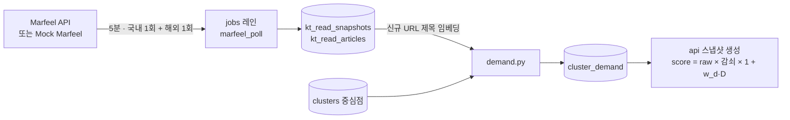

# Wire Desk — Marfeel 실시간 독자 수요 신호 설계 (r9 반영용)

- 상태: 초안 (검토 대기) · 작성일: 2026-10-22
- 대상: wire-desk PoC 인수인계 r8([2026-10-12-wire-desk-poc-handoff-v2-r8.md](2026-10-12-wire-desk-poc-handoff-v2-r8.md))에 추가할 Marfeel 수집·점수 반영 설계. r9 본문은 이 문서를 근거로 따로 개정한다.
- 근거 실측: [Marfeel 수집 가능 데이터 범위 8절](../references/marfeel-data-scope.md#8-실시간-기사별-조회국가-분리호출-한도경쟁사-2026-10-22-실측) (2026-10-22, KT site 9291)
- 표기: **[결정]** = Kwak 확정, **[작성자 판단]** = 이 문서 작성 시 정한 값(검토 시 확인 요망), **[열린 결정]** = 구현 중 측정 후 정함, **[확인 필요]** = 외부·사내 확인

## 1. 목적과 이유

해외 통신 기사 선별에서 Marfeel은 "KT 독자가 지금 이 주제를 읽고 있는가"를 알려주는 실시간 수요 신호다. 기사를 직접 고르지 않고, 기존 보도 집중도 점수(`raw_score` × 감쇠)를 KT 독자 기준으로 보정한다. **[결정]**

- Marfeel은 KT 사이트에 이미 올라간 기사의 조회만 센다. 아직 쓰지 않은 통신 사안은 조회수가 0이므로, **"이 사안과 같은 인물·주제를 다룬 KT 기사가 지금 얼마나 읽히는가"**를 그 사안의 예상 관심도로 쓴다. **[결정]**
- 강한 곳: 후속 보도, 확산 중인 이슈, KT 고정 관심 분야(한국 경제, 북한, 한미 관계 등). 국제 목록(11~20)에서는 "세계적으로 큰 뉴스"와 "KT 독자가 읽는 뉴스"를 구분하는 데 쓴다.
- 약한 곳: 완전히 새로운 대형 속보. 이것은 기존 점수(여러 통신사 동시 보도)가 이미 잡는다. Marfeel이 메울 필요가 없다.

## 2. 목표 · 비목표 · 반목표

**목표**
1. wire-desk 안에서 Marfeel Reporting API를 5분 주기로 호출해 국내·해외 독자별 KT 기사 조회를 수집한다.
2. 수집한 KT 기사를 임베딩 유사도로 통신 사안에 연결해 `D_domestic`·`D_overseas`를 계산하고, 추천 점수에 곱셈형 가산(최대 +50%)으로 반영한다.
3. KT가 이미 쓴 사건에 새 통신 기사가 들어오면 후속 보도 후보로 추천에 다시 올린다(r8 규칙 변경, 5절).
4. **PoC에서 실제 Marfeel API를 붙이고, 실제 KT 인기 기사와 연결된 추천 결과를 보고서에 보인다.** 통신 사안은 실제 KT 인기 기사 제목에서 만든 반합성 데이터를 쓴다. **[결정]**

**비목표 (이번 범위 밖)**
- 유입 경로(검색·Discover·소셜)별 가중(역할 4). `source` 차원은 동작이 확인됐으나 쓰지 않는다. **[작성자 판단]**
- 경쟁사 감점(`P_comp`)의 Marfeel 연동. 이 API로는 경쟁사 데이터가 없다(실측). Marfeel Monitoring 계약 여부를 담당자에게 확인하기 전까지 RSS 방식을 유지한다. **[확인 필요]**
- GA4 대체 경로. Marfeel 장애 시에는 가산 0으로 처리한다(4.6). **[작성자 판단]**
- 실제 통신 데이터(Herb 실데이터)와 실제 Marfeel의 결합 검증, 가중치 `w_d` 확정. S1 Shadow 단계로 넘긴다.
- Google Trends·Wikipedia 등 외부 신호(r8 범위 밖 유지).

**반목표 (기술적으로 동작해도 실패로 본다)**
- Marfeel 가산 때문에 대형 속보가 추천에서 밀린다.
- 보도량이 거의 없는 사안이 Marfeel 신호만으로 상위에 오른다.
- 계정 공유 한도(분당 1회)를 넘겨 KT의 다른 Marfeel 사용(사람·자동화)을 막는다.
- Marfeel 장애가 추천 자체를 멈춘다.

## 3. 제약

**Marfeel API (실측, 2026-10-22)**

| 항목 | 값 | 설계 영향 |
| --- | --- | --- |
| 호출 한도 | 계정당 분당 1회. 즉시 재호출 시 HTTP 429 `{"msg":"Exceeded rate limit"}`. 한도 헤더 없음 | 호출 간격을 직접 기록·관리. 5분 주기에 최대 5회 |
| 응답 행 | 최대 500행. `url × country` 그룹은 30분에 500행 초과 | 국가는 그룹화 대신 필터 2회 |
| 실시간 | `granularity: realtime` → `minutely_5`(기본)·`minutely_1`. 지연 약 1분. 기간은 `{"last":{"number":30,"dimension":"minute"}}` | 최근 30분 창. `day` 단위는 오늘을 빼므로 쓰지 않음 |
| 국가 필터 | `country` 필터 값은 GeoNames ID. 한국 `1835841`. 국가명은 HTTP 204 | 어댑터 안에 숨김 |
| 행 구성 | `url` 그룹에 홈페이지·비기사 URL이 섞임 | URL 패턴으로 기사만 남김 |
| 잘못된 입력 | 틀린 필터는 조용히 무시(200)되거나 204 | 필터 효과를 합계로 검증 |
| 인증 | `POST /api/user/signin` → Bearer 토큰(문서상 최대 14일) | 13일마다 재발급, 401 시 1회 재발급 |

**r8 고정 결정과의 정합**
- worker는 3개 레인을 유지한다(고정 3). Marfeel 폴링은 **jobs 레인의 주기 작업**으로 둔다. 새 레인을 만들지 않는다. **[작성자 판단]**
- api와 worker는 DB로만 소통한다(고정 4). 시간은 `Clock`으로만 다룬다(고정 6). 외부 연동은 어댑터 하나에 모은다(고정 22, `herb_client.py`와 같은 방식).
- 감쇠 점수는 api가 스냅샷을 만들 때 계산한다(고정 17·r7). Marfeel 가산도 같은 시점에 곱한다.
- 실데이터 정책(고정 27)은 통신사 원문 대상이다. KT 기사 제목·URL은 KT가 이미 공개한 자사 기사이므로 `source=real` 차단 대상으로 보지 않는다. 외부 임베딩(OpenAI)과 픽스처 생성용 LLM에 보낼 수 있다고 본다. **[작성자 판단, 사내 확인 필요]** 조회수 녹화본은 사내 분석 데이터이므로 커밋하지 않는다(`.gitignore`). **[작성자 판단]**

## 4. 설계

### 4.1 구성 요소와 배치

```
wire_desk/
  marfeel_client.py      # 신규: 인증·토큰 캐시, 쿼리 조립(국가 ID·기간), 호출 간격·429, 응답 매핑, 기사 URL 판별
  demand.py              # 신규: KT 기사 ↔ 사안 연결, D_domestic·D_overseas 계산
  lanes/jobs.py          # 변경: marfeel_poll 주기 작업 추가
  lanes/analyze.py       # 변경: KT 기작성 판정 → 후속 대기·복귀(5절)
  api.py / render.py     # 변경: 스냅샷 생성 시 (1 + w_d × D) 곱, "후속" 표시, 근거 기록
  config.py              # 변경: marfeel 블록(부록 A)
mock_marfeel/server.py   # 신규: 녹화본을 가상 시각 기준으로 재생하는 /api/dashboard/query
tools/marfeel_record.py  # 신규: 실시간(RealClock) 녹화 실행기. marfeel_poll과 같은 코드 경로 사용
fixtures/marfeel/        # 신규: recordings/*.jsonl (gitignore), 반합성 생성 입력
fixtures/generate.py     # 변경: 반합성 사안 생성(6.2)
eval/run_eval.py         # 변경: G19 측정(7절)
```

데이터 흐름:



### 4.2 수집 (`marfeel_poll`, jobs 레인)

- 주기: `Clock` 기준 5분. 한 주기에 다음 두 요청을 보낸다. 두 요청 사이는 65초 이상 둔다.
  - 국내: `filters: [{"filter":"country","op":"eq","value":["1835841"]}]`
  - 해외: `filters: [{"filter":"country","op":"neq","value":["1835841"]}]`
  - 공통: `dates.last = 30 minute`, `granularity: realtime`, `groupBy: ["url","title"]`, `metrics: ["pageViewsTotal","uniqueUsers"]`, `order: pageViewsTotal DESC`, `limit: 200` **[작성자 판단: limit]**
  - `groupBy`의 `title`은 실시간에서 실측하지 않았다. 안 되면 `url`만 받고 제목은 별도 경로로 얻는다(10절 T0).
- 호출 간격: 마지막 호출 시각을 DB(`api_calls`, target=`marfeel`)에 남기고, 프로세스가 재시작해도 이 값으로 65초 간격을 지킨다. 같은 계정을 쓰는 녹화 실행기와 worker가 동시에 돌지 않게 한다.
- 429: 그 주기의 남은 요청은 건너뛴다. 바로 재시도하지 않는다. 다음 주기에 다시 시도한다(반목표: 다른 사용자 방해 금지).
- 401: 토큰을 재발급하고 1회 재시도한다. 로그인 호출이 분당 1회 한도에 포함되는지는 모른다(10절 T0).
- 응답 검증:
  - 204가 오거나, 국내 합계와 해외 합계가 필터 없는 값처럼 보이면 그 주기를 "검증 실패"로 기록하고 반영하지 않는다. 판정 기준은 두 합계가 같거나, 한쪽이 0인데 다른 쪽만 있는 경우다. **[작성자 판단]**
  - 기사 URL 판별: 경로에 `/YYYYMMDD/` 날짜 구간이 있는 URL만 기사로 본다. 홈페이지와 섹션 페이지는 뺀다. 규칙은 설정값(정규식)이다.
- 저장
  - `kt_read_snapshots`: snapshot_id, segment(`domestic`|`overseas`), collected_at(Clock), window_minutes, status(`ok`|`rate_limited`|`invalid`|`error`), total_pv, total_uv
  - `kt_read_rows`: snapshot_id, url, page_views, unique_users, rank
  - `kt_read_articles`: url PK, title, first_seen_at, published_date(URL 날짜), excluded(bool). 임베딩은 기존 `item_embeddings`와 같은 형식의 `kt_article_embeddings`(url, model, vec)에 둔다.
- 신규 URL만 임베딩한다. 사안 임베딩과 **같은 모델**을 쓴다(열린 결정의 임베딩 모델과 연동). 이미 본 URL은 재사용한다.
- 보존: `kt_read_rows`·`kt_read_snapshots`는 7일, `kt_read_articles`·임베딩은 마지막으로 본 날로부터 30일. `maintenance` 모듈로만 삭제한다(고정 25). **[작성자 판단]**

### 4.3 KT 기사 ↔ 사안 연결과 수요 점수 (`demand.py`)

marfeel_poll이 성공한 직후, 그리고 analyze 레인이 사안 중심점을 갱신한 뒤에 계산한다. 결과는 `cluster_demand`(cluster_id, computed_at, d_domestic, d_overseas, d, evidence JSON)에 저장한다.

1. **조회 강도** `I_s(a)`: 구간 s(국내·해외) 최신 정상 스냅샷의 KT 기사 a에 대해 `log(1 + pv_a) / log(1 + pv_max_s)`로 계산한다. 0~1 값이고 `pv_max_s`는 그 구간 1위 기사(홈페이지 제외)의 PV다. **[작성자 판단, 열린 결정: 로그 비율 vs 순위 백분위]**
2. **연결 가중** `g(sim)`: `sim`은 KT 기사 제목 임베딩과 사안 중심점의 코사인 유사도다.
   - `sim < t_rel`이면 0이다.
   - `t_rel ≤ sim < t_full`이면 0에서 1로 선형으로 오른다.
   - `sim ≥ t_full`이면 1이다.
   - 시작값은 `t_rel` 0.55, `t_full` 0.75이고, 언어쌍별 분리 여부는 기존 열린 결정과 함께 정한다. **[열린 결정]**
   - KT 기작성 연결 임계값 `t_same`(5절)과 순서를 지킨다. 반드시 `t_rel < t_full < t_same`이어야 한다. `t_same`이 `t_full` 이하이면 가산이 최대인 사안이 곧바로 `kt_covered`로 빠져 같은 주제 가산이 사라진다.
3. **구간 수요** `D_s(c) = max_a g(sim(a,c)) × I_s(a)`. 합 대신 최댓값을 쓴다. 약한 연결이 많이 쌓여 점수가 부풀지 않게 하려는 것이다. **[작성자 판단, 열린 결정: max vs 상위 3개 평균]**
4. **통합 수요** `D(c) = 0.5 × D_domestic + 0.5 × D_overseas`. 국내·해외 5:5. **[결정]**
5. **점수 반영** (api 스냅샷 생성 시): `score = raw_score × 0.5^(경과/반감기) × (1 + w_d × D(c))`
   - `w_d` 시작값은 0.5다(최대 +50%). **[결정: 상한 +50%]** 값 자체는 S1에서 정한다. PoC는 `w_d ∈ {0, 0.25, 0.5}`를 비교한다.
   - 곱셈형이라 `raw_score`가 낮은 사안은 Marfeel만으로 오르지 못한다(반목표).
6. **신선도**: `cluster_demand.computed_at`이나 그 근거가 된 스냅샷이 15분보다 오래되면 `D = 0`으로 본다. Marfeel이 멈추면 기존 점수만 남는다. **[작성자 판단]**
7. **근거 기록**: `evidence`에는 구간별 상위 3개 KT 기사의 url·title·pv·sim·g를 남긴다. `rec_snapshots.rows`에 `d_domestic`, `d_overseas`, `d`, `evidence`, `followup`을 함께 고정 저장한다. 보고서와 관리자 화면이 이것을 근거로 보여준다.
8. **연결 대상**: 최근 48시간 `active` 사안이다. `kt_covered`(후속 대기) 사안은 점수를 계산하지만 추천에는 나오지 않는다(5절).

계산량: KT 기사 최대 400개 × active 사안 수백 개면 5분마다 벡터 곱 수만 건이다. pgvector나 메모리 행렬곱으로 충분하다고 본다. 구현 방식은 구현자가 정한다.

### 4.4 추천 화면

- 후속 보도 후보는 같은 10개 자리에서 일반 사안과 경쟁하고, 제목 앞에 **"후속"** 표시만 붙인다. 별도 칸이나 우선순위는 없다. **[결정]**
- 가산은 화면에 숫자로 보이지 않는다. 관리자 화면(`Wire Desk Admin`)에서만 사안별 `D`와 근거 KT 기사를 볼 수 있다. **[작성자 판단]**

### 4.5 기존 점수와의 관계

- `raw_score`(최대 67), 감쇠, 한국 관련 10건과 국제 10건 분리, 만료 규칙은 r8 그대로다.
- Marfeel 가산은 한국 관련과 국제 두 목록 모두에 적용한다. 국제 목록에서는 KT 독자 반응이 낮은 주제(예: 유럽 축구)가 상대적으로 밀리는 효과가 난다(역할 2).

### 4.6 장애·한도 상황

| 상황 | 동작 |
| --- | --- |
| 429 | 그 주기의 남은 요청을 건너뛰고 `rate_limited`로 기록. 3주기 연속이면 `outbox`로 운영 알림 |
| 401 | 토큰 재발급 후 1회 재시도. 실패하면 `error`로 기록하고 알림 |
| 204·검증 실패 | `invalid`로 기록하고 반영하지 않음. 알림 |
| 네트워크·5xx | 다음 주기에 재시도. 지수 백오프 없음(주기 자체가 간격) |
| 15분 넘게 정상 스냅샷 없음 | `D = 0`. 추천은 기존 점수로 계속 |

## 5. r8 변경: KT 기작성 사안의 후속 보도 복귀

r8 §5.5④의 "KT 제외"는 `kt_covered`를 추천에서 영구히 뺀다. 이것을 다음과 같이 바꾼다. **[결정: 후속 보도 후보로 다시 올라와야 함]**

- KT 기사와의 연결 판정은 기존 규칙을 유지한다(`kt_articles.source_delivery_id` 일치, 아니면 임베딩 유사도 `t_same` 이상). 연결되면 `status = kt_covered`가 되고 `kt_article_id`와 `kt_covered_at`(= KT 기사 발행 시각)을 기록한다.
  - r8에는 `t_same` 숫자가 없다. 시작값은 0.85로 하고 `t_full`(0.75)보다 높게 유지한다(4.3). G7⑤(KT 겹침 제외 ≥ 9, 오제외 ≤ 1)와 G19-③을 함께 보고 조정한다. **[작성자 판단, 열린 결정]**
- **합류 후보**: 새 item의 사안 비교 대상은 최근 48시간 `active`와 `kt_covered` 사안이다. r8은 `active`만 본다. `kt_covered`를 빼면 같은 사건의 새 기사가 새 사안으로 갈라져 후속 복귀가 일어나지 않는다. 만료 규칙(`last_item_at` 후 48시간)은 `kt_covered`에도 똑같이 적용한다. **[작성자 판단]**
- **복귀 조건**: `kt_covered` 사안에 r7 감쇠 갱신 대상 item이 합류하고, 그 item의 `created_dt > kt_covered_at`이면 복귀한다. 갱신 대상 item은 새 edition이나 새 통신사 합류다.
  - 복귀하면 `status = active`, `followup = true`, `followup_at`을 기록한다.
  - 판 갱신, 정정·취소 공지, `created_dt`가 KT 발행 전인 늦은 도착분으로는 복귀하지 않는다.
- 복귀 후 감쇠는 기존 규칙대로 그 item의 `created_dt`부터 다시 시작한다.
- 복귀한 사안은 같은 사건을 다룬 KT 기사가 지금 읽히고 있으면 Marfeel 가산이 크게 붙는다. 이 신호가 가장 강하게 작동하는 경우다.
- KT가 같은 사건으로 두 번째 기사를 쓰면 다시 `kt_covered`로 돌아간다. `followup`은 true로 남는다. 이 과정은 반복될 수 있다.
  - 두 번째 기사는 `kt_covered_at` 이후에 발행된 KT 기사 중 이미 연결된 `kt_article_id`와 다른 것으로 판정한다.
  - 복귀한 사안을 이미 연결된 KT 기사로 다시 제외하지 않는다. **[작성자 판단]**
- 스키마 변경: `clusters`에 `followup bool default false`, `followup_at`, `kt_covered_at`을 추가한다. 인덱스는 구현자가 정한다.

## 6. PoC 검증: 실제 Marfeel 녹화 + 반합성 사안

### 6.1 녹화 (실제 API)

- `tools/marfeel_record.py`가 `RealClock`으로 **48시간 이상** 돌며 4.2와 같은 코드로 실제 API를 호출한다. 결과는 `fixtures/marfeel/recordings/`(gitignore)와 DB에 쌓인다. 평일을 포함한다. **[작성자 판단]**
- 녹화 자체가 수집 안정성 측정이다(G19-①). 녹화 기간에 계정을 함께 쓰는 다른 작업은 멈추거나 조율한다. **[확인 필요: 계정 공유 사용자·작업 유무]**

### 6.2 반합성 사안 생성 (`fixtures/generate.py` 확장)

- 입력: 녹화본에서 구간별 PV 상위 KT 기사를 고른다. 국내 30개와 해외 30개, 중복 제외. **[작성자 판단]** 각 기사의 제목, URL 날짜, 인기 정점 시각을 쓴다.
- 씨앗 기사마다 기존 생성기 방식(LLM)으로 통신 기사를 만든다. 유형과 라벨은 다음과 같다.

| 유형 | 내용 | 기대 결과 |
| --- | --- | --- |
| ① same_event | 씨앗과 같은 사건. KT 발행 전 1~2판 + 발행 후 새 edition·새 통신사 | 발행 전: 씨앗 자체로는 가산 없음(아직 발행 전). 같은 주제의 다른 KT 기사가 읽히고 있으면 가산될 수 있음(필수 아님). 발행 후: `kt_covered` → 새 기사로 **후속 복귀** + 씨앗 기사 조회로 가산 |
| ② same_topic | 같은 인물·기관·주제의 다른 사건 | 가산. `kt_covered` 아님 |
| ③ unrelated | KT 인기 기사와 무관한 사안(대조군) | 가산 없음 |
| ④ breaking | 대형 속보. 5개 이상 통신사가 동시 보도하고 KT 기사는 없음 | 가산 없음. 순위 유지 |
| ⑤ revision_only | ①의 사건에 KT 발행 후 판 갱신·정정만 들어옴 | 후속 복귀 없음 |

- `kt_articles.jsonl`에 씨앗 KT 기사 전부를 넣는다(실제로 KT가 발행한 기사이므로). **[작성자 판단]**
- **씨앗 발행 시각** = 녹화본에서 그 URL이 처음 나타난 스냅샷 시각이다. 녹화 시작 시점에 이미 있던 기사(첫 스냅샷에 등장)는 발행 전 구간이 없으므로 ① 유형에 쓰지 않고 ②·⑤ 유형 씨앗으로만 쓴다. 아직 발행되지 않은 기사의 조회로 가산이 붙는 모순을 막기 위해서다. **[작성자 판단]**
- 씨앗 발행 시각을 기준으로 합성 사안의 `created_dt`를 배치하고, 녹화본과 같은 가상 시각에 재생한다.
- **G19는 별도 재생으로 측정한다.** 녹화 기간(48시간 이상)을 그대로 가상 시간축으로 쓰고, 그 위에 6.2 유형 ①~⑤만 올린다. 기존 r8 합성 픽스처(평일 24시간, G1~G18 기준값의 전제)와는 섞지 않는다. 기존 측정 구조와 기준값을 바꾸지 않기 위해서다. **[작성자 판단]**
- 라벨(`labels.jsonl` 확장): `marfeel_seed_url`, `relation`(위 유형), `expect_boost`, `expect_followup`

### 6.3 재생

- `mock_marfeel/server.py`가 `/api/dashboard/query`를 흉내 낸다. 가상 현재 시각 이전 가장 최근 녹화 스냅샷을 돌려준다. 한도는 Mock Herb처럼 재생 속도에 맞춰 늘리거나 줄인다(§5.5⓪).
- 같은 재생을 `w_d = 0 / 0.25 / 0.5`로 세 번 돌려 비교한다.

### 6.4 보고서에 보일 것

- 시점별(예: 2시간마다) 추천 20건을 `w_d = 0`과 `0.5`로 나란히 비교한다. 순위가 바뀐 사안마다 근거 KT 기사(제목, URL, 국내·해외 PV, 유사도)를 단다.
- 후속 보도로 복귀한 사례 목록: KT 기사, 발행 시각, 복귀를 일으킨 통신 기사.
- **한계를 명시한다.** 통신 사안이 KT 기사에서 파생됐으므로 연결률은 실제보다 높게 나온다. 실제 통신 데이터와 Marfeel의 결합 성능, 추천 적중률, `w_d` 확정은 S1 Shadow 단계에서 검증한다.

## 7. 측정 지표 (r8 §8에 G19로 추가)

| ID | 지표 | 기준 (시작값) |
| --- | --- | --- |
| G19-① | 녹화 48시간 주기 성공률(국내·해외 둘 다 `ok`) | ≥ 95% |
| G19-② | 60초 안 연속 호출 | 0회. 429는 계정 외부 요인 포함 집계만 |
| G19-③ | ①·② 유형 가산 재현율(`D > 0.2`) | ≥ 80% |
| G19-④ | ③ 유형 오가산율(`D > 0.2`) | ≤ 10% |
| G19-⑤ | ④ 대형 속보의 순위 하락(`w_d 0.5` vs `0`) | 최대 2계단, 상위 3위 이탈 0건 |
| G19-⑥ | ① 유형 후속 복귀율 / ⑤ 유형 오복귀 | ≥ 90% / 0건 |
| G19-⑦ | Marfeel 15분 정지 시 추천 응답 | 정상 응답, `D = 0` |
| G19-⑧ | 기존 G7(국내 편향) 지표 변화 | 보고만 (기준 없음) |

기준값은 모두 **[작성자 판단]**이며 결과에 따라 보고서에서 조정을 권고한다.

- 판정 시점 (G19-③·④): 사안이 추천 대상(`active`)인 동안 5분(가상 시간)마다 계산한 `D`의 **최댓값**으로 판정한다. ① 유형은 KT 발행 이후 구간만 본다. **[작성자 판단]**
- G19-⑤·⑥은 2시간마다 찍는 비교 스냅샷(6.4) 기준이다.

## 8. 설정 골격 (부록 A, `config.py`)

```yaml
marfeel:
  enabled: true
  base_url: https://api.newsroom.bi        # PoC 재생은 mock_marfeel
  poll_minutes: 5
  min_call_interval_s: 65
  window_minutes: 30
  limit: 200
  segments:
    domestic: { op: eq,  country_ids: ["1835841"] }
    overseas: { op: neq, country_ids: ["1835841"] }
  article_url_pattern: '/\d{8}/'          # 홈페이지·섹션 제외
  token_max_age_days: 13
  stale_after_minutes: 15
  alert_after_failed_cycles: 3
demand:
  intensity: log_ratio                    # 열린 결정: log_ratio | rank_pct
  link: { t_rel: 0.55, t_full: 0.75 }     # 열린 결정
  aggregate: max                          # 열린 결정: max | top3_mean
  segment_weights: { domestic: 0.5, overseas: 0.5 }
  w_d: 0.5                                # 상한 +50%. S1에서 확정
followup:
  enabled: true
  reset_on: [new_edition, new_agency]     # 감쇠 갱신 대상과 같음
  require_created_after_kt_publish: true
```

비밀값(`MARFEEL_EMAIL`, `MARFEEL_SECRET`)은 환경변수로만 받는다. 토큰은 DB나 메모리에 두고 로그에 남기지 않는다.

## 9. 구현자에게 맡기는 것

- 테이블 인덱스, 마이그레이션 방식(기존 열린 결정과 동일), 벡터 계산 방식(pgvector vs 메모리)
- Mock Marfeel 응답의 세부 형식. 실제 응답 구조(`actualData.values`·`data`·`label`)를 그대로 녹화해 재생하면 된다.
- 반합성 사안 중 각 유형의 수, 기존 픽스처와 섞는 비율
- 관리자 화면에서 근거를 보여주는 표의 모양

## 10. 착수 전 확인 (T0 스파이크에 추가)

| # | 확인 | 실패 시 |
| --- | --- | --- |
| 1 | 실시간에서 `groupBy: ["url","title"]`이 제목을 주는가 | `url`만 받고, 제목은 Herb 자사 기사 조회나 별도 일 단위 쿼리로 보완 |
| 2 | 로그인 호출이 분당 1회 한도에 포함되는가 | 포함되면 토큰 재발급을 주기 호출 예산에 넣음 |
| 3 | `limit: 200`에서 국내·해외 30분 행 수가 잘리는가 | 잘리면 상위만으로 충분한지 판단(PV 하위는 강도가 낮음) |
| 4 | 계정을 함께 쓰는 사람·자동화가 있는가 **[확인 필요]** | 있으면 호출 시간대 조율, 녹화 중 중지 요청 |
| 5 | KT 기사 제목을 외부 임베딩·LLM에 보내도 되는가 **[확인 필요]** | 회신 전에는 OpenAI 기준으로 진행한다(공개 자사 기사, 합성 사안과 같은 모델). 금지로 회신되면 G19 연결 평가만 기존 `eval/bge_m3_offline.py` 경로의 오프라인 배치로 돌린다. 상시 파이프라인에는 BGE-M3를 넣지 않는다(r8 고정 3 유지). **[작성자 판단]** |

## 11. 작업 순서 [결정]

현재 wire-desk 저장소에는 ingest·jobs 레인만 있고 analyze(T5: 사안 묶기·점수·감쇠·KT 제외)는 아직 없다(2026-10-22 확인).

1. **수집·녹화 먼저**: `marfeel_client.py`, `marfeel_poll`(jobs 레인), `tools/marfeel_record.py`, 수집 테이블을 먼저 만든다. 10절 T0 확인 1~4를 함께 하고, 곧바로 48시간 이상 녹화를 시작한다. 녹화 대기가 다른 작업을 막지 않게 하려는 것이다.
2. **T5에 처음부터 포함**: T5 계획에 4.3 수요 계산, 5절 후속 복귀(합류 후보·`t_same` 포함), `cluster_demand`, 스냅샷 근거 기록을 넣는다. r8 KT 제외 규칙을 만든 뒤 다시 고치는 일을 피한다.
3. **녹화가 끝나면**: 반합성 생성(6.2), Mock Marfeel(6.3), G19 별도 재생과 보고서(6.4·7절)를 진행한다.

## 12. 다음 단계

1. 이 문서를 검토하고 승인한다.
2. 구현 계획을 쓴다(작업 목록·순서·검증). 구현은 이번 범위가 아니다.
3. r9 개정 시 반영할 곳: §3.1(jobs 레인 주기 작업), §4(범위), §5.4(테이블), §5.5④(점수식·후속 복귀), §6(Mock Marfeel·반합성), §8(G19), §11(확인 필요), 부록 G(설정)
